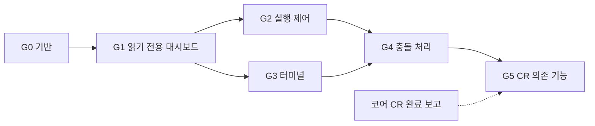

# asd-gui 개발 진행 계획 (DEV_PLAN)

> **이 문서의 성격**: 이번 `asd-gui` 개발을 **어떻게 진행할지**에 대한 작업 계획서입니다. 제품의 기능·구조는 [GUI_ARCHITECTURE.md](./GUI_ARCHITECTURE.md)가 기준이며, 이 문서의 규칙(병행 진행, 보고, 단계 순서)은 **제품 코드나 제품 명세에 반영하지 않습니다.** 개발이 끝나면 이 문서는 참고 기록으로만 남습니다.
>
> **현재 상태**: 계획 확정 단계이며 **실행 전**입니다.
>
> **관련 문서**: 코어 작업 지시는 [CORE_CHANGE_REQUEST.md](./CORE_CHANGE_REQUEST.md)(0.0절: 병행 안내, CR별 보고, 최종 `2.3.2`).

---

## 1. 진행 방식 개요

* 코어 담당(`asd-multiagent`)이 CORE_CHANGE_REQUEST.md의 CR을 구현하는 동안, GUI 담당은 **현재 코어에 이미 있는 함수만으로 만들 수 있는 부분(G0~G4)**을 먼저 개발합니다.
* CR이 필요한 기능(G5)은 **사용자가 코어 완료 보고를 전달한 뒤** 개발합니다.
* 개발 중 GUI의 코어 의존 표기는 `2.3.2`입니다(4장 5번). 개발 중 아직 CR이 없는 기능은 **해당 단계까지 구현하지 않을 뿐**, 제품 안에 "코어 진행 상황 감지"나 "기능 비활성화" 장치를 넣지 않습니다.

## 2. 병행 개발 규칙

| # | 규칙 | 이유 |
|---|---|---|
| R1 | 코어는 **브랜치 또는 git worktree**에서 작업하고, CR 단위로 테스트 통과 후 `asd-multiagent` main에 병합합니다. GUI는 main 체크아웃을 `file:` 의존성으로 참조합니다. (CORE_CHANGE_REQUEST.md 0.0절에도 명시) | `file:` 의존성은 심볼릭 링크라 코어 작업 트리의 중간 상태가 GUI를 바로 깨뜨림 |
| R2 | GUI 개발·테스트는 **임시 홈(`--home <dir>`) + 샌드박스 프로젝트**에서 합니다. 실제 `~/.asd`와 실제 프로젝트를 쓰지 않습니다. | 코어 DB 마이그레이션(CR-01 등)과 GUI 테스트가 실제 데이터를 건드리지 않게 함 |
| R3 | GUI에 코어 로직을 임시로 구현하지 않습니다(GUI_ARCHITECTURE.md ADR-01). CR이 아직 없으면 그 기능은 아직 만들지 않습니다. | 코드 중복 금지, 임시 코드 잔존 방지 |
| R4 | 코어 진행 상황은 **사용자가 전달합니다.** GUI 담당은 코어 저장소의 브랜치·커밋을 보고 완료를 추정해 G5를 시작하지 않습니다. | 진행 판단의 단일 창구를 사용자로 고정 |
| R5 | G0 착수 시 프로젝트 생성 명령과 설치 패키지 목록을 먼저 제시하고 사용자 승인을 받습니다. 이후 단계도 사용자 지시로 시작합니다. | 사용자 규칙(사전 승인) |

## 3. 단계별 계획

### G0. 기반
| 항목 | 내용 |
|---|---|
| 프로젝트 구성 | Vite + React + TypeScript, `src/shared`, `src/server`, `src/web` 구조, `file:../asd-multiagent` 의존성 (설치는 R5에 따라 승인 후) |
| 공용 프로토콜 | `src/shared/protocol.ts`: GUI_ARCHITECTURE.md 6장의 REST/WS 타입 정의 |
| 서버 골격 | HTTP + WS, `127.0.0.1` 바인딩, `--port`/`--port 0`/`--home`/`--no-open`, ready JSON 줄, 표준 오류 형식 |
| 보안 | 토큰 발급·쿠키 교환·Host/Origin 검사·경로 검증 (GUI_ARCHITECTURE.md 6.4) |
| 코어 호출 모듈 | `src/server/core-api.ts`: 코어 import를 한 곳에 모음 (제품 구조, GUI_ARCHITECTURE.md 2장) |
| 빌드 | esbuild 서버 번들, Vite 웹 빌드, `dev`/`build`/`start` 스크립트 |
| 테스트 기반 | 임시 홈 + 임시 git 저장소 픽스처. 픽스처에서 `handlePlan`(명시적 `sessionId`)으로 세션·태스크 생성 |
| **완료 기준** | 토큰 없는 요청 401, 잘못된 Host 403, 웹 빈 화면 로드 |

### G1. 읽기 전용 대시보드 (기존 코어 함수)
| 항목 | 사용 코어 함수 |
|---|---|
| 프로젝트 목록·열기·폴더 탐색 | `listKnownProjects`, `resolveAsdPaths`, `collectDashboardSnapshot` |
| 상태 감시 + `state_updated` + `task_status_changed` | `collectDashboardSnapshot` |
| 사이드바 세션 트리 | `snapshot.sessions`, `allTasks` (이 단계에서는 세션의 `main_harness`를 표시. 드라이버 표시는 G5에서 교체) |
| 최근 하네스 대화 목록 | `snapshot.cliRecentSessions` |
| PLAN 보드 (Turn별 칸반, 읽기 전용) | `snapshot.allTasks` |
| TopBar (프로젝트·브랜치·하네스 상태) | `snapshot.harnesses` |
| 다국어 기반(ko/en) | `snapshot.systemLocale` |
| **완료 기준** | CLI로 태스크 상태를 바꾸면 GUI에 반영, 프로젝트 전환 동작 |

### G2. 실행 제어 (기존 코어 함수)
| 항목 | 사용 코어 함수 | 비고 |
|---|---|---|
| Job 레지스트리 + `job_*` 이벤트 | - | |
| [Turn 실행] | `handleDispatch({ sessionId, turn, mode: "parallel_spawn" })` | |
| 서브에이전트 로그 실시간 스트리밍 + `log_closed` | `output.log` 증분 | |
| SubagentInspector (메타·로그) | 스냅샷 `subagentLogs` | |
| kill / retry / fallback / custom | `runSubagentControlAction` | **resume은 이 단계에서 만들지 않음** (G5, CR-13) |
| 디베이트 실행 | `handleDebate` | |
| PLAN.md 편집기 + `baseVersion` 충돌 검사 | `syncPlanFromMd` | 전경 세션 처리는 G5(CR-14). 그 전까지 테스트는 세션 1개 샌드박스에서만 |
| 세션 메모 | `saveSessionMemo` | |
| 라우팅 설정·모델 목록 | `loadRoutingConfig`, `saveProjectRoutingConfig`, `discoverHarnessModels` | |
| **완료 기준** | 샌드박스에서 Turn 실행 → 로그 스트리밍 → `done` 반영, kill/retry 동작 | |

### G3. 터미널 (기존 코어 함수)
| 항목 | 사용 코어 함수 |
|---|---|
| PTY 매니저, 탭 관리, 재접속 유예 | `resolveSpawnCommand` |
| xterm.js TerminalPane | - |
| 최근 대화 [>_ 터미널] (이어하기) | `buildInteractiveResumeHarnessCommand` |
| 서브에이전트 [>_ 터미널 열기] (worktree cwd) | 같음 |
| 새 대화형 하네스 / OS 셸 탭 | 같음 |
| `node-pty` 불가 시 명령 복사만 제공 | - |
| `closeTabsInPath` | - |
| **완료 기준** | Windows에서 5대 하네스 대화형 실행, 크기 조절, 종료 처리 |

### G4. 병합 충돌 처리 (기존 코어 함수)
| 항목 | 사용 코어 함수 | 비고 |
|---|---|---|
| `merge_conflict` 카드·토스트 | 스냅샷 | |
| Diff 모달 | `getWorktreeDiff` | CR-08 전에는 충돌 Diff가 비어 보이는 것이 정상(코어 미완). 완료 기준 검증은 CR-08 이후 |
| [Worktree에서 터미널 열기] → 수동 해결 | G3 | |
| [재검증 및 병합] | `approvePendingTask` | |
| [반려] | `rejectPendingTask` | |
| [AI로 충돌 해결] | - | 이 단계에서 만들지 않음 (G5, CR-13) |
| **완료 기준** | 충돌 픽스처에서 터미널로 해결 → 재병합 `done`, 반려 → `failed` + worktree 삭제 | |

### G5. CR 의존 기능 (사용자 보고에 따라)
4장 트리거 표를 따릅니다.

## 4. 실행 트리거 규칙

1. **G0~G4**: 코어 진행과 무관하게, 사용자가 지시하면 순서대로 진행합니다.
2. **G5**: 사용자가 코어 담당의 완료 보고를 확인하고 GUI 담당에게 "CR-xx 완료"(가능하면 보고 원문 포함)를 알려주면, 그때:
   1. 보고의 "추가/변경된 공개 API"와 "이 문서와 달라진 점"을 확인하고, GUI_ARCHITECTURE.md(4.3절 등)와 `src/shared/protocol.ts`를 실제 시그니처에 맞게 갱신합니다.
   2. 아래 표에서 **새로 진행 가능해진 항목만** 개발합니다(필요 CR이 여러 개인 항목은 모두 완료된 경우에만).
   3. 완료 후 사용자에게 어떤 기능을 만들었는지 보고합니다.
3. 진행 중인 G0~G4 작업과 G5 트리거가 겹치면, 어느 쪽을 먼저 할지 사용자에게 묻습니다.
4. 코어가 `2.3.2` 최종 완료를 보고하면, 남은 G5 항목과 전체 E2E(5장)를 진행합니다.
5. **마지막 작업**: 코어 `2.3.2` 완료 + GUI G5·E2E 완료 후, GUI의 코어 의존 표기(`package.json` 및 GUI_ARCHITECTURE.md ADR-01-5)를 `2.3.2`로 유지/확인합니다.

**CR → GUI 작업 매핑**
| 사용자 보고 | 새로 개발 가능한 GUI 기능 |
|---|---|
| CR-15 + CR-01 완료 | [+ 새 세션], DriverBar(표시·교체·이력), 세션 트리의 드라이버 표시 |
| CR-02 + CR-03 완료 (CR-01 선행) | GUI 프롬프트 입력, [AI 계획 생성], 브리핑 주입 표시 |
| CR-04 완료 (CR-01 선행) | PTY 드라이버 부착(`asDriverOf`), 최근 대화 [드라이버로 연결] |
| CR-08 완료 | 충돌 Diff `committed` 모드 표시, G4 완료 기준 재검증 |
| CR-09 완료 | 프롬프트·로그 삭제 후 화면 처리(대화 기록 탭 안내) |
| CR-10 완료 | 대화 기록 탭(드라이버·서브·최근 대화) |
| CR-11 완료 | `423 LOCKED` 응답 처리 |
| CR-12 완료 | 고아 복구 호출(서버 시작·프로젝트 열기·30초 주기)과 표시 |
| CR-13 완료 | 서브에이전트 [후속 지시(Resume)], [AI로 충돌 해결] |
| CR-14 완료 | 전경 세션 전환, PLAN.md 편집기의 전경 세션 처리 |
| CR-07, CR-17 완료 | GUI 변경 없음 (회귀 테스트만) |
| 2.3.2 최종 완료 | 남은 G5 정리 + 전체 E2E → 완료 후 의존 표기 `2.3.2`로 갱신 |

## 5. 검증
* 각 단계 완료 시 `tests/server`(node:test)로 REST/WS 계약 테스트를 추가합니다.
* E2E(GUI_ARCHITECTURE.md 9장 시나리오 1·2·3·5·6·7·8)는 G5 이후 일괄 작성합니다. 도구는 GUI_ARCHITECTURE.md 11장 미결 #9(Playwright 기본안).
* 모든 테스트는 R2에 따라 임시 홈·샌드박스에서 실행합니다.

## 6. 일정 개요 (추측)

| 구간 | 코어 담당 | GUI 담당 |
|---|---|---|
| 1 | CR-15, CR-01 | G0, G1 |
| 2 | CR-02, CR-03, CR-04 | G2, G3 |
| 3 | CR-08 ~ CR-14 | G4 + G5(보고된 CR 분) |
| 4 | CR-07, CR-17 → 2.3.2 | G5 나머지 + 전체 E2E → 의존 표기 2.3.2 갱신 |
