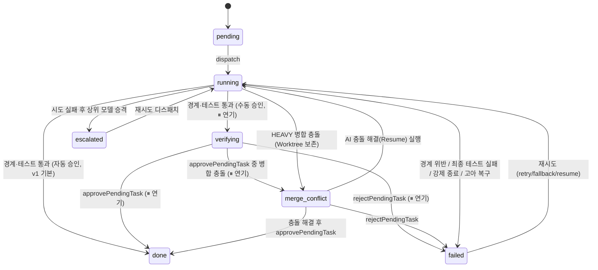

# ASD GUI & Multi-Harness Session Management — Architecture & Implementation Specification (v2)

> **문서 목적**: `asd-multiagent`(CLI 및 코어 오케스트레이션 엔진, npm 이름 `agent-swarm-director`)를 코드 복사 없이 재사용하여, 5대 AI 코딩 하네스(`claude-code`, `opencode`, `codex`, `antigravity`, `cursor`)의 메인(드라이버) 세션·서브에이전트 세션·대시보드·Git Worktree 승인 게이트를 통합 제어하는 **`asd-gui`(`GUI-web` 브라우저 버전 + `GUI-app` Electron 데스크톱 버전)**의 설계 명세서입니다.
>
> **코어 변경 요청서**: 이 설계를 위해 `asd-multiagent`에 필요한 변경은 별도 문서 [CORE_CHANGE_REQUEST.md](./CORE_CHANGE_REQUEST.md)에 `CR-xx` 번호로 정리되어 있습니다. 본 문서에서 `[CR-xx]` 표기가 붙은 항목은 **코어에 아직 구현되지 않은 기능**입니다.
>
> **개발 진행 계획**: 이번 개발의 진행 방식(코어 병행, 단계 순서, 보고·트리거)은 [DEV_PLAN.md](./DEV_PLAN.md)에 있으며 제품 명세에 포함되지 않습니다.
>
> **표기 규칙**
> * `✅ 확인됨`: 2026-11-01 기준 `asd-multiagent` 소스에서 직접 확인한 사실
> * `[CR-xx]`: 코어 변경이 필요한 미구현 항목
> * `⚠ 확인 필요`: 근거가 부족하여 구현 전 검증이 필요한 항목
> * `미결`: 아직 의사결정이 내려지지 않은 항목 (11장)

---

## 0. 변경 이력

| 버전 | 일자 | 내용 |
|---|---|---|
| v1 | 2026-11 이전 | 최초 작성 (1 세션 = 1 메인 하네스, 하네스 변경 시 새 세션) |
| v2.3 | 2026-11-01 | 이번 개발의 진행 계획(코어 병행 규칙·개발 단계·실행 트리거)은 제품 명세가 아니므로 [DEV_PLAN.md](./DEV_PLAN.md)로 분리. 의존 코어 버전은 `2.3.2`로 표기(ADR-01-5). `handlePlan` 등 호출 시 `sessionId` 명시 규칙 추가(6.1) |
| v2.2 | 2026-11-01 | **수동 승인 모드 연기.** 코어에 켜는 경로가 없는 미노출 기능이므로 웹 v1에서 제외(ADR-05). 승인모드 토글·`verifying` UI·`auto-approve` API 제거, 병합 충돌 처리는 유지. CR-05·06·16 연기 |
| v2.1 | 2026-11-01 | **`GUI-app`(Electron) 개발 연기.** `GUI-web`을 먼저 개발하고 Electron은 웹 버전 안정화 이후 착수(ADR-02, 8장). Electron 관련 내용은 설계 참고용으로 보존 |
| v2 | 2026-11-01 | ① ASD 세션 = 작업 단위, 메인 하네스 = 교체 가능한 **드라이버(driver)** 목록(ADR-06) ② 대화 본문은 하네스 저장소에서 직접 읽고 ASD는 포인터만 저장, `output.log`/`prompt.md`는 실행 중에만 유지, `cli-recent.json`은 인덱스로 유지(ADR-07) ③ 수동 승인 모드에서 LIGHT → HEAVY 강제 승격(ADR-05) ④ 훅 자동 연결 금지 ⑤ 보안 토큰·크로스 프로세스 잠금·고아 태스크 복구·작업 이벤트 추가 ⑥ v1의 코드 불일치(phase, 컬럼, 함수명, 파일 경로) 정정 |

---

## 목차

1. [아키텍처 의사결정 (ADR)](#1-아키텍처-의사결정-adr)
2. [저장소 구조](#2-저장소-구조)
3. [파일 시스템 및 SQLite 데이터 스키마](#3-파일-시스템-및-sqlite-데이터-스키마)
4. [`asd-multiagent` 공개 API 레퍼런스](#4-asd-multiagent-공개-api-레퍼런스)
5. [5대 하네스 명령어·세션 ID·트랜스크립트 매트릭스](#5-5대-하네스-명령어세션-id트랜스크립트-매트릭스)
6. [백엔드 (`src/server`) 명세](#6-백엔드-srcserver-명세)
7. [프론트엔드 (`src/web`) 명세](#7-프론트엔드-srcweb-명세)
8. [데스크톱 앱 (`src/app`) Electron 명세](#8-데스크톱-앱-srcapp-electron-명세)
9. [E2E 워크플로우 시나리오](#9-e2e-워크플로우-시나리오)
10. [코어 선행 구현 상태](#10-코어-선행-구현-상태)
11. [미결 사항 및 검증 필요 항목](#11-미결-사항-및-검증-필요-항목)

---

## 1. 아키텍처 의사결정 (ADR)

### ADR-01: 코어/CLI와 GUI의 저장소 분리 및 코어 재사용
1. `asd-multiagent`는 **Zero-dependency(`"dependencies": {}`)** 원칙을 유지하며 `package.json`의 `exports`로 내부 모듈을 공개합니다. ✅ 확인됨 (`.`, `./core/*`, `./adapters/*`, `./cli/*`, `./mcp/*`, `./core/plan` → `render.ts`)
2. `asd-gui`는 별도 Git 저장소(`../asd-gui`)이며 `"agent-swarm-director": "file:../asd-multiagent"`로 참조합니다.
3. DB 쿼리, 라우팅, 서브에이전트 스폰, 시크릿 마스킹, Worktree 생성/검증/병합, 세션 추적, 트랜스크립트 읽기 로직은 **`asd-gui`에 복사하지 않고 import**합니다. GUI 쪽에 코어 로직이 필요해지면 GUI에서 구현하지 않고 `CORE_CHANGE_REQUEST.md`에 CR로 추가합니다.
4. **주의 (B-14)**: 코어는 `.ts` 소스를 그대로 export합니다. npm `file:` 설치는 심볼릭 링크라 실경로가 `asd-multiagent/src/...`가 되어 동작하지만, 복사 설치(`npm pack` 등)로 `node_modules` 안에 `.ts`가 놓이면 Node 타입 제거 기능이 거부할 수 있습니다(⚠ 확인 필요). 따라서 `asd-gui` 서버는 **esbuild로 번들링**(코어 소스 인라인, `node-pty`는 external)하여 `dist/server.js`로 실행합니다(8.2 참고). 번들링은 빌드 산출물이며 소스 복사가 아니므로 ADR-01-3을 위반하지 않습니다.
5. **의존 코어 버전**: 현재 `agent-swarm-director` **`2.3.2`**에 의존합니다. 코어 기능 유무를 런타임에 감지하거나 분기하지 않습니다(버전은 문서와 의존성 선언으로만 표기, `file:` 의존성은 버전 범위를 강제하지 않음).

### ADR-02: 단일 UI 코드베이스로 `GUI-web`과 `GUI-app` 동시 지원
1. `src/web`: React + Vite + TypeScript + `xterm.js` 프론트엔드.
2. `src/server`: 로컬 Node.js 서버(HTTP REST + WebSocket + `node-pty`).
3. **`GUI-web`**: `asd-gui` 서버를 띄우고 브라우저로 접속합니다. 기본 포트 `4173`, 사용 중이면 실패하고 안내합니다(`--port 0`으로 자동 할당 가능).
4. **`GUI-app`** — **⏸ 연기 (v2.1)**: Electron 메인 프로세스가 서버를 **시스템 Node 자식 프로세스**로 띄우고(포트 자동 할당) 같은 `src/web` 번들을 `BrowserWindow`로 렌더링합니다(8장). **개발 순서: `GUI-web` 먼저 완성 → 이후 Electron 착수.** 웹 개발 중에도 서버·웹 코드는 Electron에서 그대로 재사용할 수 있게 유지합니다(예: 폴더 선택은 `window.asdDesktop`이 있으면 네이티브, 없으면 `browse-dirs` 모달로 분기하는 인터페이스만 남겨 둠).
5. 기존 `asd-multiagent`의 내장 경량 대시보드(`asd ui`, `src/cli/dashboard.ts`의 `startDashboardServer`)는 CLI 단독 사용자를 위해 보존합니다.

### ADR-03: 별도 GUI DB 없음, 프로젝트 폴더 기반 로드 + 2-Tier 세션 인덱스
1. GUI 전용 중앙 DB를 만들지 않습니다. 프로젝트를 열면 `<project>/.asd/`와 `~/.asd/state/<project-hash>/core.db`를 읽습니다.
2. 최근 프로젝트 목록은 `listKnownProjects()`가 `~/.asd/state/*/core.db`를 스캔해 구성합니다. ✅ 확인됨
3. **Tier 1 — 하네스 대화 인덱스 (`<project>/.asd/sessions/cli-recent.json`)**
   * `/asd` 없이 나눈 일반 CLI/IDE 대화를 포함한 **모든 메인 역할 하네스 대화의 인덱스**입니다(대화 본문 아님). 항목마다 하네스, 네이티브 세션 ID, 0-Token 요약, 시각, 연결된 ASD 세션 ID, 트랜스크립트 경로만 저장합니다. 최대 100건. ✅ 확인됨 (`MAX_RECENT_CLI_SESSIONS = 100`)
   * 기록 경로: 훅(`asd hook ...`)이 실시간 기록(기본) + `syncLocalHarnessTranscripts`가 하네스 저장소를 스캔해 누락분 보충(보조).
   * 대화 본문은 저장하지 않습니다(ADR-07).
4. **Tier 2 — ASD 세션 (`<project>/.asd/sessions/<asd-id>/` + `core.db`)**
   * `/asd*` 명령 실행 또는 GUI에서 정식으로 시작한 **작업 단위**입니다. 태스크, PLAN, Worktree, 승인 상태, **드라이버 목록**(ADR-06)을 가집니다.

### ADR-04: 네이티브 세션 ID(`harnessSessionId`) 캡처와 양방향 Resume
1. 각 하네스의 자체 세션 ID(`session_id`, `thread_id`, `sessionID`, `conversation_id`, `chat_id`)를 **드라이버 행(`session_drivers`)**과 **서브에이전트 `meta.json`**에 기록합니다.
2. 이를 통해 다음이 가능합니다.
   * CLI에서 하던 대화를 GUI에서 이어받기 (CLI → GUI)
   * GUI에서 실행한 드라이버/서브 세션을 일반 터미널에서 이어받기 (GUI → CLI)
   * 특정 서브 하네스에게 기존 컨텍스트 그대로 후속 지시하기 (규칙은 ADR-09 및 6.6 참고)
3. 하네스 간 세션 ID는 호환되지 않습니다. 다른 하네스로 바꾸는 것은 Resume이 아니라 **드라이버 교체**(ADR-06)입니다.

### ADR-05: 수동 승인 모드 — ⏸ 연기 (v2.2)

> **상태: 연기.** 웹 v1에서는 만들지 않습니다. 모든 태스크는 **자동 승인(`autoApprove: true`)**으로 동작합니다. 아래는 나중에 착수할 때 쓸 설계안입니다.
>
> **연기 근거** (2026-11-01 코드 확인): 코어에 내부 함수(`verifying` 일시정지, `approvePendingTask`, `rejectPendingTask`)는 있지만, **켜는 경로가 없습니다.** MCP 도구 스키마에 `autoApprove`가 노출되지 않았고, CLI 명령·스킬 안내도 없으며, `approvePendingTask`를 부르는 곳은 테스트(`gui-prerequisites.test.ts`)뿐입니다. 기본값이 항상 `true`라 사용자 입장에서는 존재하지 않는 기능입니다.
>
> **웹 v1에서의 처리**
> * GUI는 승인모드 토글, `verifying` 칸, 승인/반려 버튼을 **제공하지 않습니다.** 세션 생성·디스패치 시 `autoApprove`를 보내지 않습니다(코어 기본값 `true`).
> * 만약 DB에 `verifying` 태스크가 있으면(테스트 등 외부 경로로 생긴 경우) 카드에 "승인 대기(GUI v1 미지원)"로 표시만 하고 조작은 제공하지 않습니다.
> * 기존 코어의 `verifying` 관련 코드는 건드리지 않습니다(켤 방법이 없으므로 영향 없음).
> * **병합 충돌(`merge_conflict`)은 자동 모드에서도 생기므로** Diff 뷰어, 반려(`rejectPendingTask`), Worktree 터미널, 충돌 해결 후 재병합(`approvePendingTask`), CR-08은 v1에 포함합니다. 수동 승인을 나중에 붙일 때 이 기반을 그대로 재사용합니다.
> * 관련 코어 변경 CR-05·CR-06·CR-16은 CORE_CHANGE_REQUEST.md에서 "연기" 절로 옮겼습니다.

**착수 시 설계안 (참고용)**
1. 세션 단위 `autoApprove: boolean`(기본 `true`, `sessions.auto_approve`). 디스패치 요청에서 1회성으로 덮어쓸 수 있습니다(`AsdDispatchInput.autoApprove`). ✅ 확인됨 (타입·핸들러에는 존재, MCP 스키마에는 미노출)
2. **수동 승인 모드(`autoApprove: false`)에서는 모든 태스크를 HEAVY(격리 Worktree)로 실행합니다.** `[CR-05]`
   * 근거: LIGHT 태스크를 메인 작업 트리에서 `verifying`으로 보류하면, 반려 시 `rollbackLightChanges`가 `git reset HEAD -- .` + `git checkout -- .` + `git clean -fd`로 **작업 트리 전체를 되돌려** 다른 태스크와 사용자의 변경까지 지웁니다. ✅ 확인됨 (`workspace.ts` `rollbackLightChanges`)
   * 승격은 디스패치 시점에 결정하며 `tasks.track`을 `HEAVY`로 바꾸고 `tasks.promoted_from_light = 1`을 기록합니다. GUI는 카드에 "LIGHT→HEAVY(수동 승인)" 배지를 표시합니다.
   * 자동 승인 모드에서 LIGHT 동작은 변경하지 않습니다.
3. 검증(파일 경계 `allowedFiles` + `verify_cmd`)을 통과하면 병합하지 않고 `verifying`으로 전환하며 Worktree(`.asd/wt/<turn>-<taskId>`)를 보존합니다. ✅ 확인됨
4. 사용자가 Diff를 확인한 뒤:
   * **[승인]** → `approvePendingTask` → 검증 재실행 → Worktree 커밋 → `--no-ff` 병합 → (선택) 스모크 체크 → Worktree 정리 → `done`
   * **[반려]** → `rejectPendingTask` → Worktree와 브랜치 삭제 → `failed`
5. 승인 모드 토글은 **세션 값(`sessions.auto_approve`)을 바꾸며 다음 디스패치부터 적용**됩니다. 이미 `verifying`인 태스크에는 영향이 없습니다. 디스패치는 시작 시점에 읽은 세션 값을 사용합니다.
6. 착수 시 GUI 추가 항목: `PUT /api/sessions/auto-approve`(`updateSessionAutoApprove` `[CR-16]`), TopBar 승인모드 토글, 새 세션 폼의 승인모드 입력, PlanBoard `verifying` 칸과 [Diff 검토] 버튼, Diff 모달의 [승인 및 병합]/[반려 및 폐기], `approve`/`reject`의 `verifying` 상태 허용, 9장 시나리오 4.

### ADR-06: ASD 세션 = 작업 단위, 메인 하네스 = 교체 가능한 드라이버 (v2 신규)
1. **배경**: 사용자는 한 작업 중에도 메인 하네스를 Claude Code → OpenCode → Antigravity 등으로 수시로 바꿉니다(쿼터 소진, 모델 선호 등). 하네스 간 세션 ID는 호환되지 않습니다.
2. **기각된 대안**: "하네스가 바뀌면 새 ASD 세션". 태스크는 `tasks(session_id, task_id)`로 세션에 묶여 있어서(✅ 확인됨), 새 세션으로 옮기면 `verifying`/`merge_conflict`/`worktree_path`/`commit_sha`/`attempts`가 이전 세션에 남고 이전 세션의 Worktree가 주인 없는 상태가 됩니다.
3. **결정**
   * ASD 세션은 PLAN, 태스크, Worktree, 승인 상태를 **계속 소유**합니다.
   * 메인 하네스 세션은 **드라이버**로 세션에 부착됩니다. 드라이버 목록은 **추가만(append-only)** 하며 덮어쓰지 않습니다.
   * 세션당 **활성 드라이버는 최대 1개**입니다. 새 드라이버를 붙이면 기존 활성 드라이버는 `detached_at`이 기록됩니다.
   * 드라이버 행에는 포인터(하네스, 네이티브 세션 ID, 모델, 시각, 출처)만 저장하고 대화 본문은 저장하지 않습니다(ADR-07).
   * `sessions.main_harness / main_model / harness_session_id`는 **활성 드라이버의 미러**로 유지합니다(기존 CLI 코드 호환).
4. **컨텍스트 이어주기 (0-Token 브리핑)**: 새 드라이버는 이전 대화를 모릅니다. 새 드라이버의 첫 프롬프트 앞에 코어가 LLM 호출 없이 생성한 **드라이버 브리핑**을 붙입니다. `[CR-02]`
   * 내용: 세션 ID·메모, 진행 보드(`renderProgressBoard`), 승인 대기/충돌 태스크 목록, 최근 완료 태스크의 `done_claim` 요약, `summary.md`(있으면), 이전 드라이버 목록(하네스/모델/기간), PLAN.md 경로, 사용 가능한 ASD MCP 도구 안내.
   * 길이 상한: 기본 6,000자. 초과 시 완료 태스크 요약부터 잘라냅니다.
5. **새 ASD 세션을 만드는 경우**: 작업 주제가 바뀔 때만 만듭니다. 하네스 변경은 새 세션 사유가 아닙니다.

### ADR-07: 대화 본문은 하네스에서 직접 읽고 ASD는 포인터만 저장 (v2 신규)
1. **배경**: 하네스는 자체 저장소에 대화를 저장합니다. ASD가 같은 내용을 또 저장하면 중복이고 저장 공간을 낭비합니다.
2. **유지하는 것 (포인터·메타데이터)**: `harness`, `harnessSessionId`, `model`, `taskId`, `status`, `pid`, `worktreePath`, 시각, `transcriptPath`, `cli-recent.json` 인덱스. 하네스는 ASD 태스크 ID를 모르므로 "T1.1 = codex 세션 X" 같은 매핑은 ASD에만 있습니다.
3. **실행 중에만 유지하는 것**: 서브에이전트/드라이버 실행의 `output.log`, `prompt.md`. 실행 중 실시간 표시와 실행 직후 코어 후처리(보고 파싱, 폴백 판정, 디베이트 집계)에 쓰인 뒤, **태스크/실행이 종결 상태에 도달하면 삭제**합니다. `[CR-09]`
   * 종결 상태: 태스크 `done`/`failed`, 디베이트 `done`, 드라이버 실행 종료. `verifying`/`merge_conflict`/`escalated`는 종결이 아니므로 유지합니다(검토 중 참고용).
4. **종료 후 조회**: GUI는 `readHarnessTranscript`로 하네스 저장소를 직접 읽어 표시합니다. `[CR-10]` 읽기에 실패하면 "원본 대화 기록 없음 — 하네스에서 직접 열기" 안내와 Resume 명령 복사 버튼을 보여줍니다.
5. **시크릿 마스킹**: 하네스 원본 트랜스크립트는 마스킹되지 않은 원문입니다. 코어 리더가 `redactSecrets`를 적용한 결과만 GUI로 전달합니다.
6. **포맷 불안정성**: 하네스 저장 포맷은 공식 문서가 없는 내부 포맷이며 업데이트로 바뀔 수 있습니다. 리더는 하네스별로 분리하고, 파싱 실패 시 예외 대신 `found: false`를 반환합니다.

### ADR-08: 로컬 서버 보안 (v2 신규)
1. Origin 검사만으로는 부족합니다. 브라우저가 아닌 로컬 프로세스는 `Origin` 헤더를 위조할 수 있고, `pty_spawn`은 셸을 띄우므로 사실상 임의 명령 실행입니다.
2. **세션 토큰**: 서버 기동 시 `crypto.randomBytes(32)` 토큰을 생성하고 모든 REST/WS 요청에 요구합니다(6.4).
3. **Host 헤더 검사**(DNS rebinding 방지), **Origin 검사**, **`127.0.0.1` 바인딩**을 함께 적용합니다.
4. 경로 파라미터(`projectRoot`, `cwd`, `dir`)는 절대 경로·존재 여부를 검증하고, ASD 세션 ID는 `^[A-Za-z0-9._-]{1,64}$`만 허용합니다(디렉토리명으로 쓰이므로 경로 탈출 방지). `[CR-15]`

### ADR-09: 동시성·소유권·Resume 규칙 (v2 신규)
1. **크로스 프로세스 병합 잠금**: 기존 `mergeMutex`는 프로세스 내부 잠금입니다(✅ 확인됨, `AsyncMutex`). GUI 서버와 하네스가 띄운 `asd mcp`가 동시에 병합할 수 있으므로 파일 잠금 `.asd/merge.lock`을 추가합니다. `[CR-11]`
2. **고아 태스크 복구**: 실행 프로세스가 죽었는데 `running`으로 남은 태스크를 서버 시작/프로젝트 열기 시 복구합니다. `[CR-12]`
3. **Resume 규칙**: 서브에이전트 Resume은 "검증 게이트를 거치는 작업"으로 처리하고, 하네스 변경 Resume은 금지합니다. `[CR-13]` (6.6)
4. **PLAN.md 전경 세션**: PLAN.md 파일은 프로젝트당 하나이며 상단 `Session: <id>` 헤더의 세션이 **전경 세션**입니다. 전경이 아닌 세션은 PLAN.md를 덮어쓰지 않습니다. `[CR-14]` (6.7)

---

## 2. 저장소 구조

```text
C:\Users\yjsjs0987\Desktop\Projects\
│
├── asd-multiagent/                          # [저장소 1] CLI & 코어 엔진 (Zero-dependency, name: agent-swarm-director)
│   ├── package.json                         # exports 맵, engines.node >= 22.13.0
│   ├── src/
│   │   ├── index.ts                         # 루트 Barrel Export
│   │   ├── core/
│   │   │   ├── types.ts                     # 공용 타입 (HarnessId, TaskStatus, SessionPhase, *Meta, Asd*Input/Output, HarnessAdapter)
│   │   │   ├── config.ts                    # resolveAsdPaths, computeProjectHash, loadRoutingConfig, ensureProjectInitialized
│   │   │   ├── db.ts                        # node:sqlite 기반 SqliteDriver, openProjectDb
│   │   │   ├── session-tracker.ts           # cli-recent.json, 세션 ID 추출, 0-Token 요약, 링크, listKnownProjects, Resume 빌더
│   │   │   ├── spawner.ts                   # spawnSubagent, resolveSpawnCommand, killProcessTree
│   │   │   ├── workspace.ts                 # 베이스라인, LIGHT/HEAVY 검증, 수동 승인, getWorktreeDiff, approve/reject
│   │   │   ├── router.ts                    # resolveRoute, escalateTaskRoute, selectDiverseReviewer, runWithFallbacks
│   │   │   ├── render.ts                    # parsePlanMd, renderPlanMd, syncPlanFromMd, renderProgressBoard, renderSessionSummaryMd
│   │   │   ├── policy.ts                    # PreToolUse / Stop 훅 평가기
│   │   │   ├── redact.ts                    # redactSecrets (시크릿 마스킹)
│   │   │   ├── debate.ts                    # 디베이트 브로커 (runDebateBroker 등)
│   │   │   └── jsonc.ts                     # JSONC/TOML 유틸
│   │   ├── adapters/
│   │   │   ├── claude-code.ts / opencode.ts / codex.ts / antigravity.ts / cursor.ts   # 5대 HarnessAdapter
│   │   │   ├── installer.ts                 # 하네스 훅/MCP/스킬 설치기
│   │   │   └── adapter-manifest.json
│   │   ├── mcp/
│   │   │   ├── server.ts                    # AsdMcpServer, handlePlan/Dispatch/Verify/Debate
│   │   │   └── stdio-rpc.ts
│   │   ├── cli/
│   │   │   ├── index.ts                     # CLI 엔트리 (init, sync, status, doctor, clean, ui, hook, mcp 등) + getAdapter, scanSubagentLogs
│   │   │   └── dashboard.ts                 # collectDashboardSnapshot, discoverHarnessModels, runSubagentControlAction, 내장 경량 UI
│   │   └── skills/                          # /asd, /asd-plan, /asd-run, /asd-debate, /asd-debug, /asd-handoff 스킬
│   └── tests/                               # node:test (gui-prerequisites.test.ts 포함)
│
└── asd-gui/                                 # [저장소 2] 통합 GUI (별도 Git 저장소)
    ├── GUI_ARCHITECTURE.md                  # 본 문서
    ├── CORE_CHANGE_REQUEST.md               # 코어 변경 요청서 (코어 담당용)
    ├── package.json                         # "agent-swarm-director": "file:../asd-multiagent"
    ├── tsconfig.json
    ├── vite.config.ts
    ├── scripts/
    │   └── build-server.mjs                 # esbuild 서버 번들 (코어 인라인, node-pty external)
    ├── src/
    │   ├── shared/
    │   │   └── protocol.ts                  # REST 요청/응답 + WebSocket 메시지 타입 (서버·웹 공용)
    │   ├── server/
    │   │   ├── index.ts                     # HTTP + WS 부트스트랩, 토큰 발급, ready 신호 출력
    │   │   ├── auth.ts                      # 토큰/Host/Origin 검증 미들웨어
    │   │   ├── context.ts                   # 프로젝트별 SqliteDriver 캐시, 경로 검증 유틸
    │   │   ├── core-api.ts                  # agent-swarm-director import를 한 곳에 모은 얇은 호출 계층
    │   │   ├── jobs/
    │   │   │   └── job-registry.ts          # 백그라운드 작업(jobId) 등록·상태·이벤트 발행
    │   │   ├── routes/
    │   │   │   ├── projects.ts              # 프로젝트 목록·열기·폴더 탐색·모델·라우팅
    │   │   │   ├── sessions.ts              # 세션 생성·메모·전경·계획·디베이트·서브에이전트 제어
    │   │   │   ├── drivers.ts               # 드라이버 부착/교체/목록, 드라이버 프롬프트 실행
    │   │   │   ├── transcripts.ts           # 하네스 트랜스크립트 조회 (readHarnessTranscript)
    │   │   │   └── tasks.ts                 # PLAN.md, 디스패치, Diff, 승인/반려, 충돌 해결
    │   │   ├── pty/
    │   │   │   └── pty-manager.ts           # node-pty 멀티플렉서
    │   │   └── watcher/
    │   │       └── state-watcher.ts         # 파일/DB 변경 감시, 디바운스 스냅샷, 로그 증분, 태스크 전이 이벤트
    │   ├── web/
    │   │   ├── index.html / main.tsx / App.tsx
    │   │   ├── api/                         # REST 클라이언트 + WS 클라이언트 (토큰 처리)
    │   │   ├── store/
    │   │   │   └── useAsdStore.ts           # Zustand 스토어 (11장 미결: 라이브러리 확정 필요)
    │   │   ├── i18n/                        # ko / en 문자열
    │   │   └── components/
    │   │       ├── TopBar/                  # 프로젝트 스위처, 브랜치, 하네스 상태 (승인모드 토글은 ⏸ 연기)
    │   │       ├── Sidebar/                 # [+ 새 세션], ASD 세션 트리(드라이버 포함), 최근 하네스 대화 목록
    │   │       ├── DriverBar/               # 활성 드라이버 표시 + [드라이버 교체] + 프롬프트 입력
    │   │       ├── PlanBoard/               # Turn별 칸반, 디스패치, PLAN.md 에디터
    │   │       ├── TranscriptView/          # 하네스 트랜스크립트 뷰어 (드라이버/서브 공용)
    │   │       ├── SubagentInspector/       # 서브에이전트 상세, 실시간 로그, Resume, PTY 열기
    │   │       ├── WorktreeDiffModal/       # Diff 검토, 승인/반려, 충돌 해결
    │   │       ├── RoutingConfigPanel/      # routing.jsonc 편집기
    │   │       └── TerminalPane/            # 온디맨드 xterm.js
    │   └── app/                             # [GUI-app 전용] Electron — ⏸ 연기 (웹 버전 이후 생성)
    │       ├── main.ts                      # 서버 자식 프로세스 기동, ready 대기, BrowserWindow
    │       └── preload.ts                   # contextBridge: pickDirectory, getAuthToken
    └── tests/
        ├── server/                          # node:test — REST/WS 계약 테스트 (임시 git 저장소 픽스처)
        └── e2e/                             # Playwright — 9장 시나리오 (11장 미결: 도입 확정 필요)
```

---

## 3. 파일 시스템 및 SQLite 데이터 스키마

### 3.1 프로젝트 로컬 `.asd/` 레이아웃

```text
<project-root>/.asd/
├── PLAN.md                                  # 전경 세션의 계획서 (상단 "Session: <id>" 헤더 = 전경 세션)
├── routing.jsonc                            # (선택) 프로젝트 전용 라우팅 오버라이드
├── merge.lock                               # [CR-11] 크로스 프로세스 병합 잠금 (병합 중에만 존재)
├── wt/
│   └── <turn>-<taskId>/                     # HEAVY Worktree (브랜치 asd/wt-<turn>-<taskId>), verifying/merge_conflict 동안 보존
└── sessions/
    ├── cli-recent.json                      # [Tier 1] 하네스 대화 인덱스 (최대 100건, 본문 없음)
    └── <asd-session-id>/                    # [Tier 2] ASD 세션 (작업 단위)
        ├── main.json                        # 세션 메타 + 드라이버 목록 미러
        ├── summary.md                       # 세션 완료 시 요약
        ├── drivers/                         # [CR-03] GUI가 헤드리스로 실행한 드라이버 턴 기록
        │   └── <driver-id>/runs/<run-id>/
        │       ├── meta.json                # 실행 메타 (status, pid, exitCode, 시각)
        │       └── output.log               # 실행 중에만 존재 (종료 후 삭제)
        └── subagents/
            └── <sub-session-id>/
                ├── meta.json                # 서브에이전트 메타 (영구, 수백 바이트)
                ├── prompt.md                # 실행 중에만 존재 [CR-09]
                └── output.log               # 실행 중에만 존재 [CR-09] (시크릿 마스킹됨)
```

### 3.2 `cli-recent.json` (`{ sessions: CliRecentSessionEntry[] }`) ✅ 확인됨
`updatedAt` 내림차순, 최대 100건. 서브에이전트 역할(`ASD_SESSION_ROLE=subagent`)의 훅 호출은 기록하지 않습니다. ✅ 확인됨

```json
{
  "sessions": [
    {
      "harnessSessionId": "claude-conv-98a7b6c5",
      "harness": "claude-code",
      "projectRoot": "C:/Users/yjsjs0987/Desktop/Projects/my-app",
      "summary": "로그인 API에서 JWT 만료 시간 처리 버그 수정해줘",
      "startedAt": 1730419800000,
      "updatedAt": 1730419950000,
      "asdSessionId": "asd-20261101-101000-k3f9",
      "model": "claude-opus-4-6",
      "transcriptPath": "C:/Users/yjsjs0987/.claude/projects/.../claude-conv-98a7b6c5.jsonl"
    }
  ]
}
```

| 필드 | 타입 | 설명 |
|---|---|---|
| `harnessSessionId` | `string` (키) | 네이티브 세션 ID |
| `harness` | `HarnessId` | `'claude-code' \| 'opencode' \| 'codex' \| 'antigravity' \| 'cursor'` |
| `projectRoot` | `string` | 프로젝트 루트 절대 경로 |
| `summary` | `string` | 0-Token 한 줄 요약 (첫 프롬프트 최대 50자 또는 `<ToolName>: <FileBasename>`) |
| `startedAt` / `updatedAt` | `number` | Unix ms |
| `asdSessionId` | `string \| null` (선택) | 이 대화가 드라이버로 부착된 ASD 세션 ID |
| `model` | `string \| null` (선택) | 감지된 모델 |
| `transcriptPath` | `string \| null` (선택) | 하네스 로컬 트랜스크립트 경로 (리더가 우선 사용) |

**GUI 표시 규칙**
* `asdSessionId`가 있으면 "드라이버 · <세션 메모>" 배지를 표시합니다.
* 트랜스크립트 원본이 사라진 항목은 리더 조회 시 "원본 없음"으로 표시합니다(목록에서 자동 삭제하지 않음).

### 3.3 `main.json` (`MainSessionMeta`) — v2

```json
{
  "sessionId": "asd-20261101-101000-k3f9",
  "roleType": "main",
  "role": "director",
  "phase": "running",
  "pid": 18420,
  "startedAt": "2026-11-01T01:10:00.000Z",
  "autoApprove": false,
  "memo": "JWT 만료 버그 수정 및 인증 미들웨어 리팩터링",

  "harness": "opencode",
  "model": "glm-5",
  "harnessSessionId": "ses_01JBQ...",

  "activeDriverId": "drv-mh2k1x-7q2c",
  "drivers": [
    { "driverId": "drv-mh2a0b-1a2b", "harness": "claude-code", "model": "claude-opus-4-6", "harnessSessionId": "claude-conv-98a7b6c5", "source": "cli-asd", "attachedAt": 1730419800000, "detachedAt": 1730423400000, "detachReason": "switched" },
    { "driverId": "drv-mh2k1x-7q2c", "harness": "opencode", "model": "glm-5", "harnessSessionId": "ses_01JBQ...", "source": "gui-headless", "attachedAt": 1730423400000, "detachedAt": null, "detachReason": null }
  ]
}
```

* `phase`: `SessionPhase = 'planning' | 'running' | 'paused' | 'done'` ✅ 확인됨 (v1의 `debating/executing/verifying/failed`는 존재하지 않는 값이므로 삭제)
* `harness` / `model` / `harnessSessionId`: 활성 드라이버 미러(기존 필드, 호환용)
* `activeDriverId` / `drivers`: `[CR-01]` DB `session_drivers`의 미러. **DB가 원본(SSOT)**이며 `main.json`은 사람이 읽기 위한 사본입니다.

### 3.4 서브에이전트 `meta.json` (`SubagentSessionMeta`) ✅ 확인됨 + v2 추가 필드

```json
{
  "subSessionId": "sub-1-T1.1-worker-codex",
  "parentSessionId": "asd-20261101-101000-k3f9",
  "roleType": "subagent",
  "role": "worker",
  "harness": "codex",
  "model": "gpt-5.4",
  "harnessSessionId": "thread_01JBM9X7Z8...",
  "taskId": "T1.1",
  "pid": 24812,
  "worktreePath": "C:/Users/yjsjs0987/Desktop/Projects/my-app/.asd/wt/1-T1.1",
  "allowedFiles": ["src/auth/**", "tests/**", "**/*.test.ts", "**/*.spec.ts"],
  "status": "done",
  "startedAt": 1730419860000,
  "finishedAt": 1730419965000,
  "durationMs": 105000,

  "dispatchMode": "parallel_spawn",
  "ownerPid": 30112,
  "exitCode": 0,
  "transcriptPath": null
}
```

* `subSessionId` 형식: `sub-<turn>-<taskId>-<role>-<harness>` ✅ 확인됨. 재시도/폴백/커스텀/Resume은 뒤에 `-retry-xxxx`, `-fb-xxxx`, `-custom-xxxx`, `-resume-xxxx`가 붙습니다. ✅ 확인됨
* `status`: `'running' | 'done' | 'failed'` (서브 프로세스 실행 결과이며 태스크 상태와 별개)
* v2 추가(`[CR-12]`): `dispatchMode`(`'parallel_spawn' | 'claim_only' | 'control_action' | 'debate'`), `ownerPid`(디스패치한 프로세스 PID), `exitCode`
* v2 추가(`[CR-10]`, 선택): `transcriptPath` — 스폰 후 리더가 찾아낸 트랜스크립트 경로 캐시

### 3.5 드라이버 실행 `meta.json` `[CR-03]`

```json
{
  "runId": "run-mh2k9a-3d1f",
  "driverId": "drv-mh2k1x-7q2c",
  "sessionId": "asd-20261101-101000-k3f9",
  "harness": "opencode",
  "model": "glm-5",
  "harnessSessionIdBefore": null,
  "harnessSessionIdAfter": "ses_01JBQ...",
  "briefingInjected": true,
  "promptPreview": "auth 미들웨어 리팩터링 계획을 세워줘",
  "pid": 41200,
  "status": "done",
  "exitCode": 0,
  "startedAt": 1730423400000,
  "finishedAt": 1730423520000
}
```
* `promptPreview`: 사용자 프롬프트 앞 80자(마스킹). 본문 전체는 하네스 트랜스크립트에 있습니다.
* 실행 기록은 드라이버당 최근 50개만 유지합니다(오래된 run 디렉토리 삭제).

### 3.6 `core.db` (`~/.asd/state/<project-hash>/core.db`) ✅ 확인됨 + v2 변경

`resolveAsdPaths(projectRoot, homeDir)`가 정규화된 경로의 해시(`computeProjectHash`)로 경로를 결정합니다. `PRAGMA journal_mode = WAL`, `busy_timeout = 5000`, `foreign_keys = ON`. ✅ 확인됨

#### 1) `sessions`
| 컬럼 | 타입 | 기본값 | 설명 |
|---|---|---|---|
| `session_id` | `TEXT PRIMARY KEY` | - | ASD 세션 ID |
| `project_root` | `TEXT NOT NULL` | - | 프로젝트 루트 |
| `main_harness` | `TEXT NOT NULL` | - | 활성 드라이버 하네스 미러 |
| `main_model` | `TEXT` | `NULL` | 활성 드라이버 모델 미러 |
| `harness_session_id` | `TEXT` | `NULL` | 활성 드라이버 네이티브 세션 ID 미러 |
| `auto_approve` | `INTEGER NOT NULL` | `1` | `1` 자동, `0` 수동 승인 |
| `main_pid` | `INTEGER` | `NULL` | 메인 프로세스 PID |
| `phase` | `TEXT NOT NULL` | `'planning'` | `'planning' \| 'running' \| 'paused' \| 'done'` |
| `state_version` | `INTEGER NOT NULL` | `1` | 단조 증가 버전 (`incrementStateVersion`, PLAN 동기화 등에서 증가) |
| `base_sha` | `TEXT` | - | 세션 시작 시 HEAD SHA |
| `stashed_work_sha` | `TEXT` | - | 자동 스태시 SHA |
| `no_progress_count` | `INTEGER NOT NULL` | `0` | Stop 훅 3-Strike 카운터 |
| `memo` | `TEXT` | `''` | 세션 메모 |
| `created_at` / `updated_at` | `INTEGER NOT NULL` | - | Unix ms |

> v1에 있던 `base_branch`, `last_incomplete_hash`는 실제 스키마에 없으므로 삭제했습니다.

#### 2) `tasks`
| 컬럼 | 타입 | 기본값 | 설명 |
|---|---|---|---|
| `task_id` | `TEXT NOT NULL` | - | `T1.1` 형식 (복합 PK `(session_id, task_id)`) |
| `session_id` | `TEXT NOT NULL` | - | FK, `ON DELETE CASCADE` |
| `turn` | `INTEGER NOT NULL` | `1` | 웨이브 번호 |
| `title` | `TEXT NOT NULL` | - | 제목 |
| `track` | `TEXT NOT NULL` | `'LIGHT'` | `'LIGHT' \| 'HEAVY'` |
| `role` | `TEXT NOT NULL` | `'worker'` | `planner \| architect \| worker \| scout \| critic` |
| `category` | `TEXT NOT NULL` | `'general'` | `visual-ui \| design \| research \| writing \| general` |
| `difficulty` | `TEXT NOT NULL` | `'medium'` | `low \| medium \| high` |
| `status` | `TEXT NOT NULL` | `'pending'` | `pending \| running \| verifying \| done \| escalated \| failed \| merge_conflict` |
| `attempts` | `INTEGER NOT NULL` | `0` | 검증 실패 횟수 |
| `assigned_harness` / `assigned_model` | `TEXT` | - | 라우터 배정 |
| `depends_on_json` | `TEXT NOT NULL` | `'[]'` | 선행 태스크 ID 배열 |
| `target_files_json` | `TEXT NOT NULL` | `'[]'` | 허용 파일 글롭 (`allowedFiles`) |
| `context_hint` | `TEXT` | - | 컨텍스트 힌트 |
| `acceptance` | `TEXT` | - | 수용 기준 |
| `verify_cmd` | `TEXT` | - | 검증 명령 |
| `done_claim_json` | `TEXT` | - | 완료 보고 `{summary, changed_files, key_decisions, risks}` |
| `worktree_path` | `TEXT` | - | HEAVY Worktree 경로 |
| `sub_session_id` | `TEXT` | - | 실행 서브에이전트 ID |
| `commit_sha` | `TEXT` | - | 체크포인트/병합 커밋 |
| `duration_ms` | `INTEGER` | - | 소요 시간 |
| `is_cross_scope` | `INTEGER NOT NULL` | `0` | 교차 범위 자동 생성 여부 |
| `promoted_from_light` | `INTEGER NOT NULL` | `0` | `[CR-05]` ⏸ 연기 — 수동 승인 착수 시 추가 (LIGHT→HEAVY 승격 표시) |
| `follow_up_of` | `TEXT` | `NULL` | `[CR-13]` 후속 태스크의 원본 태스크 ID |

> v1에 있던 `harness_override`, `thinking_effort`는 DDL에 없습니다. (`TaskRow` 인터페이스에 `thinking_effort?` 선택 필드는 존재 ✅ 확인됨, DDL에는 없음 — 코어 쪽 정리 필요 여부는 CR 문서 부록 참고)

#### 3) `debates` ✅ 확인됨
`debate_id` PK, `session_id` FK, `task_id`, `topic`, `status`(`round1 | round2 | done`), `round1_bundle_json`, `round2_bundle_json`, `insight_verdict_json`.

#### 4) `session_drivers` `[CR-01]` (신규)
| 컬럼 | 타입 | 기본값 | 설명 |
|---|---|---|---|
| `driver_id` | `TEXT PRIMARY KEY` | - | `drv-<base36 ms>-<4자 랜덤>` |
| `session_id` | `TEXT NOT NULL` | - | FK `sessions`, `ON DELETE CASCADE` |
| `harness` | `TEXT NOT NULL` | - | 하네스 ID |
| `model` | `TEXT` | `NULL` | 모델 |
| `harness_session_id` | `TEXT` | `NULL` | 네이티브 세션 ID (첫 실행 전에는 `NULL`) |
| `source` | `TEXT NOT NULL` | - | `'cli-asd'`(CLI에서 `/asd*`/MCP로 부착) \| `'gui-headless'` \| `'gui-pty'` \| `'gui-link'`(최근 대화 목록에서 연결) \| `'migrated'`(기존 세션 이관) |
| `attached_at` | `INTEGER NOT NULL` | - | Unix ms |
| `detached_at` | `INTEGER` | `NULL` | `NULL`이면 활성 |
| `detach_reason` | `TEXT` | `NULL` | `'switched' \| 'user' \| 'session_done'` |
| `briefing_injected` | `INTEGER NOT NULL` | `0` | 브리핑 주입 여부 |

* 제약: `CREATE UNIQUE INDEX ux_session_active_driver ON session_drivers(session_id) WHERE detached_at IS NULL` (세션당 활성 1개)
* 인덱스: `(session_id, harness_session_id)`
* 이관: 기존 세션은 `sessions.main_harness / main_model / harness_session_id`로 `source='migrated'` 활성 드라이버 1행을 생성합니다.

#### 5) 태스크 상태 전이도 (v2)


**충돌 시 Worktree 상태** ✅ 확인됨: HEAVY 병합은 ① Worktree 안에서 커밋 → ② 메인에서 `git merge --no-ff` → ③ 충돌 시 `git merge --abort` 후 `merge_conflict`. 따라서 `merge_conflict` 상태의 Worktree에는 **변경이 이미 커밋되어 있고** 작업 트리는 깨끗합니다. 이 때문에 현재 `getWorktreeDiff`(`git diff HEAD`)는 충돌 태스크의 Diff를 빈 값으로 반환합니다 → `[CR-08]`.

---

## 4. `asd-multiagent` 공개 API 레퍼런스

### 4.1 Import 경로 ✅ 확인됨
| Import 경로 | 실제 파일 | 비고 |
|---|---|---|
| `agent-swarm-director` | `src/index.ts` | **권장.** core 전체, 어댑터, MCP 핸들러, `getAdapter`, `scanSubagentLogs`, 대시보드 함수 재export |
| `agent-swarm-director/core/<file>.ts` | `src/core/<file>.ts` | `types`, `config`, `db`, `session-tracker`, `spawner`, `workspace`, `router`, `render`, `policy`, `redact`, `debate`, `jsonc` |
| `agent-swarm-director/core/plan` | `src/core/render.ts` | 별칭 (`core/plan.ts` 파일은 존재하지 않음) |
| `agent-swarm-director/adapters/<file>.ts` | `src/adapters/<file>.ts` | `adapters/index.ts`는 존재하지 않음. 레지스트리 `getAdapter`는 `cli/index.ts`에 있음 |
| `agent-swarm-director/cli/dashboard.ts` | `src/cli/dashboard.ts` | |
| `agent-swarm-director/mcp/server.ts` | `src/mcp/server.ts` | |

> v1에 적힌 `probeRuntimeCapabilities`, `resolveTaskRoute`, `buildSpawnCommand`는 존재하지 않습니다. 실제 이름은 `resolveRoute`(router.ts), `HarnessAdapter.buildHeadlessCommand`(types.ts)입니다.

### 4.2 기존 함수 (✅ 확인됨)

#### (1) `config.ts`
```ts
export function resolveAsdPaths(projectRoot: string, homeDir?: string): AsdPaths; // dbPath, sessionsDir 등
export function computeProjectHash(projectRoot: string): string;
export function loadRoutingConfig(/* projectRoot, homeDir 등 */): RoutingConfig;
export function ensureProjectInitialized(projectRoot: string, homeDir?: string): void;
```

#### (2) `db.ts` — `openProjectDb(projectRoot, homeDir?) → SqliteDriver`
주요 메서드: `getSession`, `getLatestSession`, `listSessions`, `createOrGetSession(SessionInput)`, `updateSessionMemo`, `updateSessionHarnessInfo(sessionId, {harnessSessionId?, mainModel?, mainHarness?, autoApprove?})`, `updateSessionPhase`, `incrementStateVersion`, `getTask`, `getSessionTasks`, `getAllTasks`, `upsertTasks`, `deleteTask`, `updateTaskStatus`, `claimWaveTasks`, `recordTaskVerified`, `recordTaskAttemptFailure`, `getSessionDebates`, `getAllDebates`, `createDebate`, `updateDebateVerdict`, `injectDebateAcceptance`, `withImmediateTx`, `close`.

> GUI 서버는 프로젝트별 `SqliteDriver`를 1개 열어 캐시하고, 프로젝트 전환/서버 종료 시 `close()`합니다.

#### (3) `session-tracker.ts`
```ts
export function listKnownProjects(options?: { homeDir?: string }): KnownProjectSummary[];
export function readCliRecentSessions(projectRoot: string): CliRecentSessionEntry[];
export function recordCliRecentSession(projectRoot, input: { harnessSessionId; harness; model?; summary?; transcriptPath?; asdSessionId? }, options?: { forceCreateDir?: boolean }): CliRecentSessionEntry | null;
export function syncLocalHarnessTranscripts(projectRoot, options?: { homeDir?; forceCreateDir? }): CliRecentSessionEntry[]; // 현재 antigravity 스캔 구현
export function extractHarnessSessionIdFromOutput(rawOutput: string, harness?: HarnessId): string | null;
export function extractHookSessionInfo(payload, harnessId): { harnessSessionId; harness; model; summary; transcriptPath };
export function buildResumeHarnessCommand(harnessOrOptions, harnessSessionId?, prompt?, model?, thinkingEffort?): { command: string; args: string[] };
export function buildInteractiveResumeHarnessCommand(harnessOrOptions, harnessSessionId?, model?): { command: string; args: string[]; cliString: string }; // sid 생략 시 새 대화형 세션
export function linkHarnessSessionToAsdSession(options): { harnessSessionId: string | null; mainModel: string | null };
// ⚠ v2에서 의미 변경: "덮어쓰기" → 드라이버 부착(attachDriver) 위임 [CR-04]
```

#### (4) `workspace.ts`
```ts
export function getWorktreeDiff(projectRoot, options?: { wtPath?; turn?; taskId? }): WorktreeDiffSnapshot;
// { targetDir, exists, changedFiles, statusShort, diff } — 현재는 `git diff HEAD` + untracked 파일 내용
// ⚠ merge_conflict(이미 커밋된 Worktree)에서는 빈 Diff → [CR-08]에서 merge-base 기준 Diff 추가
export async function approvePendingTask({ projectRoot, sessionId, taskId, db, smokeCmd? }): Promise<{ ok; status; commitSha?; changedFiles?; error? }>;
export function rejectPendingTask({ projectRoot, sessionId, taskId, db }): { ok; status };
// ⚠ LIGHT 경로는 작업 트리 전체 롤백 → [CR-07]에서 안전화
export async function withMergeLock<T>(fn: () => Promise<T>): Promise<T>; // ⚠ 프로세스 내부 잠금 → [CR-11]
```

#### (5) `dashboard.ts`
```ts
export async function collectDashboardSnapshot(options?: { projectRoot?; homeDir? }): Promise<DashboardSnapshot>;
// DashboardSnapshot = { version, projectRoot, systemLocale, timestamp, session, sessions, tasks, allTasks,
//   debates, allDebates, subagentLogs, cliRecentSessions?, routingConfig, hasLocalRouting, localRoutingPath,
//   availableModels, worktreeStatuses?, harnesses }
// v2 추가 예정 [CR-01]: drivers: Record<sessionId, DriverRow[]>
export async function discoverHarnessModels(options?: { projectRoot?; homeDir?; forceRefresh?; skipCliSpawn? }): Promise<HarnessModelCatalog>;
export function saveSessionMemo({ projectRoot, sessionId, memo, ... }): ...;
export function saveProjectRoutingConfig({ projectRoot, homeDir?, action?: "save" | "reset", routingConfig? }): { ok; hasLocalRouting; localRoutingPath; routingConfig };
export async function runSubagentControlAction({ projectRoot, homeDir?, sessionId, subSessionId, action: "kill" | "retry" | "fallback" | "custom" | "resume", prompt?, harness?, model?, waitForCompletion? }): Promise<{ ok; action; sessionId; subSessionId; newSubSessionId?; harness?; model?; status }>;
// ⚠ resume 의미 변경 [CR-13], 재시도 프롬프트를 prompt.md 대신 DB에서 재구성 [CR-09]
```

> **성능 주의**: `collectDashboardSnapshot`은 Worktree마다 `git status`를 실행하고 모델 탐색 캐시를 사용합니다. 로그 증분 같은 잦은 이벤트에서는 호출하지 않습니다(6.3).

#### (6) `mcp/server.ts`
```ts
export async function handlePlan(input: AsdPlanInput, ctx: { projectRoot }): Promise<AsdPlanOutput>;
// AsdPlanInput.action: "create" | "get" | "update" | "sync_from_md"; mainHarness?, mainModel?, harnessSessionId?, autoApprove?, tasks?
export async function handleDispatch(input: AsdDispatchInput, ctx): Promise<AsdDispatchOutput>;
// AsdDispatchInput: { sessionId, turn?, taskIds?, mode?: "parallel_spawn" | "claim_only", harness?, autoApprove? }
// 모드 기본값: 해당 Turn의 태스크가 전부 LIGHT면 claim_only, 아니면 parallel_spawn ✅ 확인됨
export async function handleVerify(input: AsdVerifyInput, ctx): Promise<AsdVerifyOutput>;
// ⚠ 현재 autoApprove를 전달하지 않아 claim_only 경로에서 수동 승인 게이트가 우회됨 → [CR-06] (⏸ 수동 승인 연기로 함께 연기, v1 영향 없음)
export async function handleDebate(input: AsdDebateInput, ctx): Promise<AsdDebateOutput>;
```

### 4.3 v2 신규 코어 API (코어 v2.3.2 구현 반영 완료 ✅)
```ts
// [CR-01] 드라이버 (`src/core/drivers.ts`)
attachDriver(db, { projectRoot, sessionId, harness, model?, harnessSessionId?, source, now? }): { driver: DriverRow; previousDriverId: string | null; changed: boolean };
setDriverHarnessSessionId(db, { projectRoot, driverId, harnessSessionId }): DriverRow;
detachDriver(db, { projectRoot, driverId, reason }): void;
getActiveDriver(db, sessionId): DriverRow | null;
listDrivers(db, sessionId): DriverRow[];
syncSessionDriversToMainJson(db, projectRoot, sessionId): void;
// [CR-02] (`src/core/drivers.ts`)
buildDriverBriefing({ db, projectRoot, sessionId, maxChars?, locale? }): string;
// [CR-03] (`src/core/drivers.ts`)
runDriverTurn({ projectRoot, homeDir?, db, sessionId, prompt, driverId?, injectBriefing?, timeoutMs?, idleTimeoutMs?, signal?, onOutput?, commandRunner? }): Promise<DriverRunResult>;
// [CR-08] (`src/core/workspace.ts`)
getCommittedWorktreeChanges(projectRoot, wtPath): string[];
// [CR-09] (`src/core/spawner.ts`)
finalizeSubagentArtifacts({ projectRoot, sessionId, subSessionId, keep? }): void;
// [CR-10] (`src/core/transcripts.ts`)
locateHarnessTranscript(harness, sessionId, options?: { homeDir?; transcriptPath? }): TranscriptLocation;
readHarnessTranscript(harness, sessionId, options?: { homeDir?; transcriptPath?; limit?; before?; maxReadBytes? }): HarnessTranscript;
// [CR-12] (`src/core/workspace.ts` & `src/core/db.ts`)
recoverOrphanedTasks({ db, projectRoot, sessionId?, now? }): Array<{ sessionId; taskId; from; to; reason }>;
SqliteDriver.tryClaimTask(sessionId, taskId): boolean;
// [CR-14] (`src/core/render.ts`)
getForegroundSessionId(projectRoot, planMdPath?): string | null;
setForegroundSession({ db, projectRoot, sessionId, planMdPath? }): { previous: string | null };
// [CR-15] (`src/core/db.ts`)
generateAsdSessionId(now?: number): string;
isValidAsdSessionId(id: unknown): id is string;
// [CR-16] ⏸ 연기
SqliteDriver.updateSessionAutoApprove(sessionId, autoApprove: boolean): void;
```

---

## 5. 5대 하네스 명령어·세션 ID·트랜스크립트 매트릭스

### 5.1 명령어 매트릭스
아래 "대화형" 열은 `buildInteractiveResumeHarnessCommand` 실제 구현 기준입니다(✅ 확인됨). 헤드리스 신규/이어하기 열은 각 어댑터의 `buildHeadlessCommand` / `buildResumeCommand` 구현을 기준으로 하며, 정확한 인자 순서는 어댑터 소스가 최종 기준입니다(⚠ 문서와 소스 불일치 시 소스 우선).

| 하네스 | 바이너리 | 헤드리스 신규 (`buildHeadlessCommand`) | 헤드리스 이어하기 (`buildResumeCommand` / `buildResumeHarnessCommand`) | 대화형 PTY (`buildInteractiveResumeHarnessCommand`) | 출력 JSON 세션 ID 키 |
|---|---|---|---|---|---|
| `claude-code` | `claude` | `claude -p "<prompt>" --output-format json --model <m>` | `claude --resume <sid> -p "<prompt>" --output-format json [--model <m>]` | 이어하기 `claude --resume <sid> [--model <m>]` / 신규 `claude [--model <m>]` | `session_id`, `sessionId`, `conversation_id` |
| `opencode` | `opencode` | `opencode run "<prompt>" --format json --model <m>` | `opencode run "<prompt>" --session <sid> --format json [--model <m>]` | 이어하기 `opencode --session <sid> [--model <m>]` / 신규 `opencode [--model <m>]` | `sessionID`, `session_id`, `sessionId` |
| `codex` | `codex` | `codex exec "<prompt>" --json -m <m> -c model_reasoning_effort="<e>"` | `codex exec resume <sid> "<prompt>" --json [-m <m>]` | 이어하기 `codex resume <sid> [-m <m>]` / 신규 `codex [-m <m>]` | `thread_id`, `threadId`, `session_id`, `conversation_id` |
| `antigravity` | `agy` | `agy -p "<prompt>" --output-format json --model <m> --effort <e>` | `agy --resume <sid> -p "<prompt>" --output-format json [--model <m>]` | 이어하기 `agy --resume <sid> [--model <m>]` / 신규 **`agy chat`** `[--model <m>]` | `conversation_id`, `conversationId`, `session_id` |
| `cursor` | `agent` | `agent -p "<prompt>" --force --output-format json --model <m>` | `agent --resume <sid> -p "<prompt>" --force --output-format json [--model <m>]` | 이어하기 `agent --resume <sid> [--model <m>]` / 신규 `agent [--model <m>]` | `chat_id`, `chatId`, `session_id`, `conversation_id` |

* Windows에서는 `resolveSpawnCommand`(spawner.ts)로 npm `.cmd` shim을 해석해 실행합니다. ✅ 확인됨
* `HarnessAdapter.buildInteractiveResumeCommand(harnessSessionId, model?)`는 세션 ID가 필수입니다. **새 대화형 세션은 반드시 `buildInteractiveResumeHarnessCommand`(session-tracker)를 사용**합니다.

### 5.2 하네스 트랜스크립트 저장 위치 (`readHarnessTranscript` 대상) `[CR-10]`
| 하네스 | 저장 위치 (Windows 기준 `%USERPROFILE%`) | 포맷 | 상태 |
|---|---|---|---|
| `claude-code` | `~/.claude/projects/<인코딩된 프로젝트 경로>/<sessionId>.jsonl` | JSONL | 디렉토리 존재 ✅ 확인됨, 세부 포맷 ⚠ 확인 필요 |
| `codex` | `~/.codex/sessions/YYYY/MM/DD/rollout-*-<threadId>.jsonl` | JSONL | 디렉토리 존재 ✅ 확인됨, 파일명 규칙 ⚠ 확인 필요 |
| `opencode` | `~/.local/share/opencode/opencode.db` (SQLite) + `storage/` | SQLite | 파일 존재 ✅ 확인됨, 스키마 ⚠ 확인 필요 |
| `antigravity` | `~/.gemini/antigravity-cli/brain/<conversationId>/.system_generated/logs/transcript.jsonl` (+ `transcript_full.jsonl`) | JSONL | ✅ 확인됨 (기존 `syncLocalHarnessTranscripts`가 이 경로를 스캔) |
| `cursor` | 알 수 없음 (`~/.cursor`는 존재하나 대화 저장 경로 미확인) | - | ⚠ 확인 필요 |

* 우선순위: `cli-recent.json`/`meta.json`의 `transcriptPath` → 하네스별 규칙 탐색 → 실패 시 `found: false`.
* **헤드리스 실행 기록 보존 여부**: `claude -p`, `codex exec`는 기록을 남기는 것으로 알려져 있으나 cursor·agy의 헤드리스 실행 보존 여부는 ⚠ 확인 필요입니다. 보존되지 않는 하네스는 실행 종료 후 GUI에서 로그를 볼 수 없으며, 이는 ADR-07에 따른 의도된 트레이드오프입니다(필요 시 해당 세션에 Resume 접속).

### 5.3 세션 ID 캡처 및 드라이버 부착 규칙 (v2)

**(A) 서브 하네스** ✅ 확인됨
`spawnSubagent`가 stdout/stderr 청크마다 `extractHarnessSessionIdFromOutput`을 실행해 처음 발견한 ID를 `meta.json.harnessSessionId`에 즉시 기록합니다. 서브 프로세스 환경변수: `ASD_SESSION_ROLE=subagent`, `ASD_MAIN_SESSION_ID`, `ASD_SUBAGENT_META`.

**(B) GUI 헤드리스 드라이버** `[CR-03]`
`runDriverTurn`이 환경변수 `ASD_SESSION_ROLE=driver`, `ASD_MAIN_SESSION_ID=<asd-id>`, `ASD_DRIVER_ID=<driver-id>`를 설정해 실행하고, 출력에서 세션 ID를 추출해 `setDriverHarnessSessionId`로 기록합니다.

**(C) GUI PTY 드라이버** `[CR-04]`
GUI가 PTY로 하네스를 띄울 때 같은 환경변수(`ASD_SESSION_ROLE=driver`, `ASD_MAIN_SESSION_ID`, `ASD_DRIVER_ID`)를 넣습니다. 하네스가 훅을 호출하면 훅이 `ASD_DRIVER_ID`를 보고 해당 드라이버의 세션 ID를 채웁니다(PTY는 출력 파싱으로 ID를 얻기 어렵기 때문).

**(D) 일반 CLI 대화의 훅 처리** `[CR-04]` (v2 핵심 변경)
| 조건 | 동작 |
|---|---|
| `ASD_SESSION_ROLE=subagent` | 아무것도 기록하지 않음 (현행 유지) |
| `ASD_DRIVER_ID` 존재 | 해당 드라이버의 `harness_session_id`가 비어 있으면 채움 + `cli-recent.json` 기록 (`asdSessionId` 포함) |
| 그 외 (일반 대화) | **`cli-recent.json`에만 기록. ASD 세션에 자동 부착하지 않음.** (현재의 "최근 세션이 done이 아니면 연결" 동작 삭제) |

> 현재 코드: `session-start`/`pre-invocation`/`stop` 훅에서 `db.getLatestSession()`이 `done`이 아니면 `linkHarnessSessionToAsdSession`으로 **덮어씁니다**(✅ 확인됨, `cli/index.ts`). 여러 세션·여러 하네스를 쓰면 무관한 잡담이 ASD 세션의 메인을 바꿔 버리므로 삭제합니다.

**(E) CLI에서 `/asd*` 실행 시 부착** `[CR-04]`
메인 하네스가 MCP `asd_plan`(create/update) 또는 `asd_dispatch`를 호출하면, MCP 서버가 호출자 세션을 다음 순서로 결정해 활성 드라이버와 다르면 `attachDriver(source='cli-asd')`를 호출합니다.
1. 입력의 `harnessSessionId` (스킬이 전달하는 경우)
2. 환경변수 `ASD_HARNESS_SESSION_ID`, `CLAUDE_SESSION_ID` 등 (현행 로직)
3. `cli-recent.json`에서 **같은 하네스**의 항목 중 `updatedAt`이 **10분 이내**인 가장 최근 항목
4. 모두 실패하면 `harness_session_id = NULL`인 드라이버를 부착(하네스만 기록)하고 이후 훅이 채우지 않습니다(정확성 우선).

**(F) GUI에서 수동 연결**
최근 대화 목록의 [이 세션의 드라이버로 연결] → `attachDriver(source='gui-link')`.

---

## 6. 백엔드 (`src/server`) 명세

### 6.1 공통 규칙
* 바인딩: `127.0.0.1` 전용. 기본 포트 `4173`, `--port 0`이면 OS 자동 할당.
* 기동 완료 시 stdout에 한 줄 JSON을 출력합니다: `{"type":"asd-gui-ready","port":<n>,"token":"<hex>"}` (Electron이 이 줄을 읽음, 8장). 웹 모드에서는 추가로 `http://127.0.0.1:<port>/?token=<hex>` 접속 URL을 사람이 읽을 수 있게 출력하고 기본 브라우저를 엽니다(`--no-open`으로 끔).
* 모든 요청 본문/응답은 JSON. 오류 응답 형식: `{ ok: false, error: { code: string, message: string } }`, HTTP 상태 4xx/5xx.
* 오류 코드 표준: `AUTH_REQUIRED`(401), `FORBIDDEN_ORIGIN`(403), `INVALID_PATH`(400), `INVALID_SESSION_ID`(400), `NOT_FOUND`(404), `CONFLICT`(409, 예: 이미 실행 중인 드라이버 턴, 잘못된 상태 전이), `LOCKED`(423, merge.lock 대기 시간 초과), `CORE_ERROR`(500).
* 프로젝트별 `SqliteDriver`는 `context.ts`에서 캐시합니다. 하나의 서버가 여러 프로젝트를 동시에 열 수 있습니다.
* 코어 호출은 `core-api.ts` 한 곳으로 모읍니다. `handlePlan`/`handleDispatch`/`handleDebate` 등 세션을 받는 코어 함수에는 **항상 `sessionId`를 명시**합니다. ✅ 확인됨: `handlePlan`은 `sessionId`가 없으면 최신 진행 중 세션을 재사용합니다(`mcp/server.ts` L660~674).
* **장기 작업은 즉시 `jobId`를 반환**하고 진행/완료는 WebSocket으로 알립니다(6.3).

### 6.2 REST API

#### 1) 프로젝트 (`/api/projects`)
| 메서드 & 경로 | 요청 | 코어 호출 | 응답 |
|---|---|---|---|
| `GET /api/projects` | - | `listKnownProjects()` | `{ projects: KnownProjectSummary[] }` |
| `GET /api/projects/browse-dirs` | `?dir=<abs>` (생략 시 홈) | `fs.readdirSync(dir, { withFileTypes: true })` (디렉토리만, 숨김 제외 옵션) | `{ currentDir, parentDir: string \| null, directories: string[], isGitRepo: boolean }` |
| `POST /api/projects/open` | `{ projectRoot }` | 경로 검증 → `resolveAsdPaths` → `recoverOrphanedTasks` `[CR-12]` → `collectDashboardSnapshot` | `DashboardSnapshot` (+ `drivers` `[CR-01]`) |
| `GET /api/projects/models` | `?projectRoot&refresh=0\|1` | `discoverHarnessModels({ projectRoot, forceRefresh })` | `{ models: HarnessModelCatalog }` |
| `GET /api/projects/routing` | `?projectRoot` | `loadRoutingConfig` | `{ config: RoutingConfig, hasLocalRouting }` |
| `PUT /api/projects/routing` | `{ projectRoot, action?: "save"\|"reset", routingConfig? }` | `saveProjectRoutingConfig` | `{ ok, hasLocalRouting, localRoutingPath, routingConfig }` |

* `projectRoot`가 Git 저장소가 아니면 열기는 허용하되 디스패치/HEAVY 기능을 비활성화하고 경고를 표시합니다.

#### 2) 세션 (`/api/sessions`)
| 메서드 & 경로 | 요청 | 코어 호출 | 응답 |
|---|---|---|---|
| `GET /api/sessions/state` | `?projectRoot` | `collectDashboardSnapshot` | `DashboardSnapshot` |
| `POST /api/sessions/create` | `{ projectRoot, harness, model?, memo?, makeForeground?: boolean (기본 true) }` | `generateAsdSessionId` `[CR-15]` → `createOrGetSession` → `main.json` 생성 → `attachDriver(source='gui-headless', harnessSessionId=null)` `[CR-01]` → `makeForeground`면 `setForegroundSession` `[CR-14]` | `{ ok, sessionId, driver: DriverRow }` |
| `POST /api/sessions/memo` | `{ projectRoot, sessionId, memo }` | `saveSessionMemo` | `{ ok, sessionId, memo }` |
| ~~`PUT /api/sessions/auto-approve`~~ | ⏸ 수동 승인 연기(ADR-05) — v1에서 제공하지 않음 | - | - |
| `POST /api/sessions/foreground` | `{ projectRoot, sessionId }` | `setForegroundSession` `[CR-14]` | `{ ok, sessionId, planMdPath }` |
| `POST /api/sessions/phase` | `{ projectRoot, sessionId, phase: "paused"\|"running"\|"done" }` | `updateSessionPhase` (done이면 활성 드라이버 `detachDriver(reason='session_done')`) | `{ ok, phase }` |
| `POST /api/sessions/plan` | `{ projectRoot, sessionId, autoApprove?, tasks: AsdPlanInput["tasks"] }` | `handlePlan({ action: "update", sessionId, tasks, ... })` (사용자가 GUI 편집기로 직접 작성한 태스크 저장, LLM 미사용) | `AsdPlanOutput` |
| `POST /api/sessions/debate` | `{ projectRoot, sessionId, taskId?, topic, proposal, files?, includeDiff?, harness? }` | `handleDebate` (백그라운드) | `{ ok, jobId, sessionId }` |
| `POST /api/sessions/subagent-action` | `{ projectRoot, sessionId, subSessionId, action, prompt?, harness?, model? }` | 6.6 규칙 검사 → `runSubagentControlAction` (백그라운드) | `{ ok, jobId, action, newSubSessionId?, taskId?, followUpTaskId? }` |

> v1의 `POST /api/sessions/link-cli`는 `POST /api/drivers/attach`로, `POST /api/sessions/prompt`는 `POST /api/drivers/prompt`로 대체되었습니다.

#### 3) 드라이버 (`/api/drivers`) — v2 신규
| 메서드 & 경로 | 요청 | 코어 호출 | 응답 |
|---|---|---|---|
| `GET /api/drivers` | `?projectRoot&sessionId` | `listDrivers` `[CR-01]` | `{ activeDriverId, drivers: DriverRow[] }` |
| `POST /api/drivers/attach` | `{ projectRoot, sessionId, harness, model?, harnessSessionId?, source: "gui-headless"\|"gui-link"\|"gui-pty" }` | `attachDriver` (같은 하네스·같은 sid가 이미 활성이면 no-op) | `{ ok, driver: DriverRow, previousDriverId: string \| null }` |
| `POST /api/drivers/prompt` | `{ projectRoot, sessionId, prompt, mode?: "chat"\|"plan" }` | 활성 드라이버로 `runDriverTurn` `[CR-03]` (백그라운드). `mode:"plan"`이면 프롬프트 앞에 "asd_plan MCP 도구로 태스크 계획을 작성하라" 지시문을 붙임 | `{ ok, jobId, runId, driverId }` |
| `POST /api/drivers/cancel` | `{ projectRoot, sessionId, runId }` | 실행 중 드라이버 턴 `AbortSignal` → `killProcessTree` | `{ ok }` |

**드라이버 프롬프트 규칙**
1. 활성 드라이버가 없으면 `409 CONFLICT`("드라이버를 먼저 선택하세요").
2. 같은 세션에서 드라이버 턴은 동시에 1개만 실행합니다. 실행 중이면 `409`.
3. 첫 턴(`harness_session_id = NULL`): `buildHeadlessCommand`로 신규 실행합니다. 이 드라이버의 `briefing_injected = 0`이고 세션에 이전 드라이버나 태스크가 있으면 `buildDriverBriefing`을 프롬프트 앞에 붙입니다.
4. 이후 턴: `buildResumeHarnessCommand`로 이어서 실행합니다.
5. 출력은 실행 중 `drivers/<driver-id>/runs/<run-id>/output.log`에 마스킹 기록되며 WS `driver_output_chunk`로 스트리밍됩니다. 종료 후 로그는 삭제되고, 화면은 `readHarnessTranscript`로 다시 그립니다.
6. 드라이버가 ASD MCP 도구를 쓸 수 있는지는 해당 하네스에 `asd init`으로 MCP가 등록되어 있는지에 달려 있습니다(⚠ 하네스별 헤드리스 모드에서 MCP 로드 여부 확인 필요). GUI는 하네스 상태(`harnesses`)와 함께 "ASD MCP 등록 여부"를 표시합니다(11장 미결: 감지 방법).

#### 4) 트랜스크립트 (`/api/transcripts`) — v2 신규
| 메서드 & 경로 | 요청 | 코어 호출 | 응답 |
|---|---|---|---|
| `GET /api/transcripts` | `?projectRoot&harness&harnessSessionId&transcriptPath?&limit=200&before?` | `readHarnessTranscript` `[CR-10]` (마스킹된 결과) | `HarnessTranscript = { found, path?, messages: Array<{ role: "user"\|"assistant"\|"tool"\|"system", text, ts?, toolName? }>, truncated, error? }` |
| `GET /api/transcripts/resume-command` | `?harness&harnessSessionId&model?` | `buildInteractiveResumeHarnessCommand` | `{ cliString, command, args }` (복사 버튼용) |

#### 5) 태스크 (`/api/tasks`)
| 메서드 & 경로 | 요청 | 코어 호출 | 응답 |
|---|---|---|---|
| `GET /api/tasks/plan-md` | `?projectRoot` | PLAN.md 읽기 + `getForegroundSessionId` `[CR-14]` | `{ content, foregroundSessionId: string \| null }` |
| `PUT /api/tasks/plan-md` | `{ projectRoot, sessionId, content, baseVersion: number }` | 전경 세션 검사 → `baseVersion`이 `state_version`과 다르면 `409` → 파일 쓰기 → `syncPlanFromMd` | `PlanSyncResult` (= `ParsedPlanTask[]` + 새 `stateVersion`) |
| `POST /api/tasks/dispatch` | `{ projectRoot, sessionId, turn?, taskIds? }` | `handleDispatch({ ..., mode: "parallel_spawn" })` (백그라운드, `autoApprove` 미전송 = 자동 승인) | `{ ok, jobId, sessionId, turn }` |
| `GET /api/tasks/diff` | `?projectRoot&sessionId&taskId` | DB에서 `worktree_path`/`turn` 조회 → `getWorktreeDiff` (`merge_conflict`면 merge-base 모드 `[CR-08]`) | `WorktreeDiffSnapshot` (+ `mode: "working" \| "committed"`) |
| `POST /api/tasks/approve` | `{ projectRoot, sessionId, taskId, smokeCmd? }` | 상태 검사(v1은 **`merge_conflict`만** 허용, 충돌 해결 후 재병합 용도) → `ptyManager.closeTabsInPath(wtPath)` → `approvePendingTask` (내부에서 merge.lock `[CR-11]`) | `{ ok, status, commitSha?, changedFiles?, error? }` |
| `POST /api/tasks/reject` | `{ projectRoot, sessionId, taskId }` | 상태 검사(v1은 `merge_conflict`만) → `closeTabsInPath` → `rejectPendingTask` | `{ ok, status: "failed" }` |
| `POST /api/tasks/resolve-conflict` | `{ projectRoot, sessionId, taskId, strategy: "ai" }` | `merge_conflict` 검사 → 해당 서브에이전트에 `runSubagentControlAction({ action: "resume", prompt: <충돌 해결 템플릿> })` (cwd = worktree) | `{ ok, jobId }` |

* **GUI의 [Turn 실행]은 항상 `parallel_spawn`**입니다. `claim_only`는 CLI 대화형 메인이 태스크를 직접 수행하는 모드이므로 GUI에서 제공하지 않습니다.
* `approve`는 승인 시 `verify_cmd`를 다시 실행합니다(✅ 확인됨: `approvePendingTask`가 `verifyAndMergeHeavyTask(autoApprove: true)` 재호출). 긴 테스트가 있으면 응답이 늦을 수 있으므로 GUI는 진행 표시를 띄웁니다. (11장 미결: approve도 job화할지)
* **충돌 해결 템플릿 (`strategy: "ai"`)**: "현재 브랜치 `asd/wt-<turn>-<taskId>`에 메인 브랜치 `<base>`를 `git merge`하고 충돌을 해결한 뒤 커밋하라. 허용 파일 `<allowedFiles>` 밖은 수정하지 말라." 실행이 끝나면 태스크는 다시 검증 흐름을 탑니다(6.6).
* **수동 충돌 해결**: GUI에서 [Worktree에서 터미널 열기] → 사용자가 직접 `git merge <base>` 후 해결·커밋 → [재검증 및 병합] = `approve`.

### 6.3 WebSocket (`/ws`)

단일 연결로 ① 상태 스냅샷 푸시 ② 로그 증분 ③ 작업/태스크 이벤트 ④ PTY 입출력을 처리합니다.

#### `state-watcher.ts` 규칙
1. 감시 대상: `~/.asd/state/<hash>/core.db`, `core.db-wal`, `<project>/.asd/sessions/**/main.json`, `**/meta.json`, `cli-recent.json`, `PLAN.md`.
2. 변경 시 **300ms trailing debounce** 후, 세션별 `(updated_at, state_version)`과 태스크 `(task_id, status, attempts, commit_sha)` 다이제스트를 비교해 바뀐 경우에만 `collectDashboardSnapshot`을 실행해 `state_updated`를 보냅니다.
3. `output.log`, `.tmp` 파일 변경으로는 **스냅샷을 다시 계산하지 않습니다**. `output.log`는 파일 오프셋을 추적해 증분만 `subagent_log_chunk`/`driver_output_chunk`로 보냅니다. 파일이 삭제되면(ADR-07) 추적을 끝냅니다.
4. 이전/현재 스냅샷의 태스크 상태를 비교해 `task_status_changed` 이벤트를 만듭니다. CLI(MCP)에서 시작한 디스패치도 GUI 알림을 받을 수 있게 하기 위함입니다.
5. Windows 파일 감시는 `fs.watch` 재귀 옵션을 쓰되, WAL 파일 이벤트가 누락되는 경우를 대비해 활성 프로젝트마다 2초 간격 `state_version`/`updated_at` 폴링을 병행합니다.

#### 클라이언트 → 서버 (`ClientWsMessage`)
```ts
type ClientWsMessage =
  | { type: "subscribe_project"; projectRoot: string }
  | { type: "unsubscribe_project"; projectRoot: string }
  | { type: "subscribe_log"; projectRoot: string; sessionId: string; subSessionId?: string; runId?: string; fromOffset?: number }
  | { type: "unsubscribe_log"; projectRoot: string; sessionId: string; subSessionId?: string; runId?: string }
  | {
      type: "pty_spawn";
      tabId: string;
      projectRoot: string;
      cwd?: string;                  // 기본 projectRoot. Worktree 경로 허용 (projectRoot 하위인지 검증)
      harness?: HarnessId;           // 생략 시 OS 기본 셸
      harnessSessionId?: string;     // 지정 시 이어하기, 생략 시 새 대화형 세션
      model?: string;
      asDriverOf?: { sessionId: string; driverId: string }; // 지정 시 ASD_SESSION_ROLE=driver, ASD_MAIN_SESSION_ID, ASD_DRIVER_ID 환경변수 주입
      cols: number;
      rows: number;
    }
  | { type: "pty_input"; tabId: string; data: string }
  | { type: "pty_resize"; tabId: string; cols: number; rows: number }
  | { type: "pty_kill"; tabId: string };
```
> v1의 `initialInput`은 삭제했습니다(사용자 입력 없이 명령을 주입하는 경로를 없애기 위함). 드라이버에게 프롬프트를 보내려면 REST `POST /api/drivers/prompt`를 사용합니다.

#### 서버 → 클라이언트 (`ServerWsMessage`)
```ts
type ServerWsMessage =
  | { type: "state_updated"; projectRoot: string; snapshot: DashboardSnapshot }
  | { type: "task_status_changed"; projectRoot: string; sessionId: string; taskId: string; from: TaskStatus | null; to: TaskStatus }
  | { type: "job_started"; jobId: string; kind: JobKind; projectRoot: string; sessionId: string; taskIds?: string[]; runId?: string }
  | { type: "job_progress"; jobId: string; message: string }
  | { type: "job_finished"; jobId: string; kind: JobKind; ok: boolean; result?: unknown; error?: string }
  | { type: "subagent_log_chunk"; projectRoot: string; sessionId: string; subSessionId: string; offset: number; chunk: string }
  | { type: "driver_output_chunk"; projectRoot: string; sessionId: string; runId: string; offset: number; chunk: string }
  | { type: "log_closed"; projectRoot: string; sessionId: string; subSessionId?: string; runId?: string; reason: "finished" | "deleted" }
  | { type: "pty_output"; tabId: string; data: string }
  | { type: "pty_exit"; tabId: string; exitCode: number }
  | { type: "pty_error"; tabId: string; message: string }
  | { type: "error"; code: string; message: string; sessionId?: string };

type JobKind = "dispatch" | "debate" | "driver_turn" | "subagent_action" | "resolve_conflict";
```
* `job_finished.result`: `dispatch` → `AsdDispatchOutput`, `debate` → `AsdDebateOutput`, `driver_turn` → `{ runId, exitCode, harnessSessionId }`, `subagent_action` → `runSubagentControlAction` 결과.
* 서버 재시작 시 진행 중이던 job은 사라집니다. 클라이언트는 재연결 후 `state_updated`로 실제 상태를 다시 맞춥니다(고아 처리는 6.5).

### 6.4 보안 (ADR-08)
1. **토큰 발급**: 서버 기동 시 32바이트 랜덤 hex 토큰 생성. 메모리에만 보관합니다(파일 저장 안 함).
2. **웹 모드 전달**: 브라우저를 `/?token=<hex>`로 엽니다. 서버는 토큰을 검증한 뒤 `Set-Cookie: asd_token=<hex>; HttpOnly; SameSite=Strict; Path=/`를 설정하고 토큰 없는 URL로 302 리다이렉트합니다.
3. **앱 모드 전달**: Electron 메인이 ready 줄에서 토큰을 읽어 `loadURL("http://127.0.0.1:<port>/?token=<hex>")`로 같은 쿠키 흐름을 사용합니다.
4. **검사**: 모든 `/api/*`와 `/ws` 업그레이드에서 ① 쿠키 `asd_token` 또는 `Authorization: Bearer <token>` 일치 ② `Host`가 `127.0.0.1:<port>` 또는 `localhost:<port>` ③ `Origin`이 있으면 같은 호스트·포트여야 함. 개발 모드(`ASD_GUI_DEV=1`)에서만 Vite 개발 서버 Origin(`http://127.0.0.1:5173`, `http://localhost:5173`)을 추가 허용합니다.
5. **경로 검증**: `projectRoot`는 절대 경로·존재·디렉토리여야 합니다. `cwd`는 `path.resolve` 후 `projectRoot` 하위여야 합니다. ASD 세션 ID는 `isValidAsdSessionId` `[CR-15]`.
6. **PTY 명령 제한**: `pty_spawn`은 `harness` 지정 시 `buildInteractiveResumeHarnessCommand` 결과만, 미지정 시 OS 기본 셸만 실행합니다. 임의 명령 문자열은 받지 않습니다.

### 6.5 동시성·복구 (ADR-09)
1. **병합 잠금**: 모든 병합·LIGHT 커밋·승인·반려는 코어 내부에서 `.asd/merge.lock`을 잡습니다 `[CR-11]`. 대기 시간 초과 시 GUI는 `423 LOCKED`와 함께 "다른 프로세스(CLI 등)가 병합 중"이라고 표시합니다.
2. **태스크 점유**: 같은 Turn을 GUI와 CLI가 동시에 디스패치해도 한 태스크가 두 번 실행되면 안 됩니다. 코어의 `pending → running` 전환이 트랜잭션 안에서 원자적인지 확인해야 합니다(⚠ 확인 필요, `[CR-12]`의 검증 항목).
3. **고아 복구**: 서버 시작, 프로젝트 열기, 30초 주기로 `recoverOrphanedTasks`를 호출합니다 `[CR-12]`. 복구된 태스크는 `task_status_changed`로 알리고 카드에 "실행 프로세스가 사라짐" 사유를 표시합니다.
4. **GUI 서버 종료 시**: 실행 중인 서브에이전트·드라이버 프로세스는 기본적으로 **종료하지 않습니다**(작업 보존). 종료 확인 대화상자에 "실행 중 작업 N개 — 계속 실행 / 모두 중지" 선택지를 제공합니다. 계속 실행한 작업의 결과는 디스패치 주체가 사라졌으므로 다음 열기 때 고아 복구 대상이 됩니다.

### 6.6 서브에이전트 제어·Resume 규칙 (ADR-09, `[CR-13]`)
| 대상 태스크 상태 | `resume` 동작 |
|---|---|
| `running` | 거부 (`409`). 먼저 `kill` |
| `merge_conflict` | 기존 Worktree에서 같은 서브 세션 Resume → 종료 후 **같은 태스크를 다시 검증**·병합 (`verifying`도 같은 규칙이나 수동 승인 연기로 v1에서는 해당 없음) |
| `failed` / `escalated` | Worktree가 남아 있으면 그곳, 없으면 새 Worktree(HEAVY) 또는 projectRoot(LIGHT)에서 Resume → 같은 태스크 재검증 |
| `done` | **후속 태스크 생성**: 같은 Turn의 다음 번호(예: `T1.3`), 제목 `[Follow-up of T1.1] <프롬프트 앞 50자>`, `follow_up_of = 'T1.1'`, 같은 `target_files_json`, `depends_on = ['T1.1']`, track은 원본과 동일 → 그 태스크로 Resume 실행 → 일반 검증 흐름 |
| 서브에이전트에 `harnessSessionId` 없음 | 거부 (`409`, "이어할 세션 없음 — retry 사용") |

* **하네스 변경 Resume 금지**: `resume`에 원본과 다른 `harness`가 오면 `400`. 다른 하네스로 다시 하려면 `retry`/`fallback`을 씁니다(새 세션으로 시작).
* 후속 태스크 ID는 PLAN.md 파서 정규식(`T<n>.<n>` / `T-<n>` / `T<n>-<n>`)에 맞아야 하므로 `T1.1.f1` 같은 형식은 쓰지 않습니다. ✅ 확인됨 (`TASK_LINE_REGEX`)
* `kill`/`retry`/`fallback`/`custom`은 현행 동작을 유지하되, 재시도 프롬프트는 `prompt.md` 대신 DB에서 재구성합니다 `[CR-09]`.

### 6.7 PLAN.md 전경 세션 규칙 (`[CR-14]`)
1. PLAN.md 상단 `Session: <id>` 헤더가 **전경 세션**입니다(파일이 없거나 헤더가 없으면 전경 없음).
2. GUI에서 세션을 선택하면 그 세션을 보여줄 뿐이고, PLAN.md를 바꾸려면 [이 세션을 PLAN.md에 표시(전경으로)]를 눌러야 합니다. 새로 만든 세션은 기본적으로 전경이 됩니다.
3. 전경 전환 시: 현재 PLAN.md의 수동 편집을 이전 전경 세션에 `syncPlanFromMd`로 먼저 반영 → 새 세션 기준으로 `renderPlanMd`.
4. 전경이 아닌 세션의 디스패치/검증도 DB는 정상 갱신하지만 **PLAN.md는 다시 쓰지 않습니다**.
5. `syncPlanFromMd(db, sessionId, ...)`는 헤더의 세션 ID와 `sessionId`가 다르면 거부합니다(다른 세션의 태스크를 지우는 사고 방지).
6. GUI의 PLAN.md 편집기는 저장 시 `baseVersion`을 보내 동시 편집 충돌을 감지합니다(6.2).

### 6.8 PTY 매니저
1. `node-pty`로 탭별 프로세스를 관리합니다. Windows에서는 ConPTY를 사용합니다.
2. 하네스 실행 파일은 `resolveSpawnCommand`로 해석합니다(`.cmd` shim 대응).
3. **`node-pty`를 불러올 수 없는 환경**: `child_process` 대체 실행은 TTY가 아니어서 하네스 TUI가 정상 동작하지 않을 가능성이 높습니다(추측). 따라서 대화형 터미널 기능을 끄고 "터미널 사용 불가 — 아래 명령을 직접 터미널에 붙여넣으세요"와 함께 `cliString` 복사 버튼만 제공합니다. OS 기본 셸 탭도 비활성화합니다.
4. `closeTabsInPath(dir)`: `cwd`가 `dir` 하위인 탭을 모두 종료합니다(Windows `EBUSY` 방지, 승인/반려/Worktree 정리 전에 호출).
5. 탭 수 상한 기본 8개. WS 연결이 끊기면 60초 유예 후 해당 연결의 탭을 종료합니다(재연결 시 `tabId`로 재부착).

---

## 7. 프론트엔드 (`src/web`) 명세

### 7.1 UX 원칙
1. **기본 화면은 GUI 워크스페이스**(드라이버 대화 + PLAN 보드)이며 터미널이 아닙니다.
2. **하네스는 언제든 바꿀 수 있습니다.** 같은 ASD 세션 안에서 [드라이버 교체]로 다른 하네스·모델을 선택합니다. 새 세션은 작업 주제가 바뀔 때만 만듭니다.
3. 브라우저 터미널(`xterm.js`)은 사용자가 **[>_ 터미널 열기]**를 눌렀을 때만 열리는 보조 뷰입니다.
4. 대화 기록은 하네스 원본을 읽어 보여줍니다. 원본이 없으면 그 사실을 숨기지 않고 표시합니다.

### 7.2 레이아웃
```text
+----------------------------------------------------------------------------------------------------+
| [TopBar] 프로젝트 ▼ [폴더 열기] | branch@sha | 하네스 상태 ●●●○●                                                       |
+------------------------+----------------------------------------------+----------------------------+
| [Sidebar]              | [Center]                                     | [Inspector]                |
|                        |                                              |                            |
| [+ 새 세션]            | [DriverBar]                                  | (선택한 서브에이전트/드라이버) |
|                        |  활성 드라이버: opencode / glm-5  [교체 ▼]   | - ID / Role / Harness/Model|
| A. ASD 세션            |  이전: claude-code (10:10~11:10)             | - Harness Session ID [복사]|
|  ▼ asd-…-k3f9 ★전경    |----------------------------------------------| - PID / 시간 / 상태        |
|    드라이버:            | 뷰 탭: [💬 대화] [📋 PLAN 보드] [⚙ Routing]   |                            |
|     • opencode (활성)   |        (열린 경우만 [>_ codex ×])            | [탭: 실시간 로그 | 대화 기록 |
|     • claude-code      |----------------------------------------------|      | Diff]                 |
|    태스크:              | [💬 대화] TranscriptView (활성 드라이버)     |                            |
|     [T1.1] codex 🔍    |  ... 하네스 원본 대화 ...                    | [액션]                     |
|     [T1.2] agy ✔       |  (실행 중이면 실시간 출력 스트림)             | - [후속 지시 (Resume)]     |
|                        |----------------------------------------------| - [>_ 터미널 열기]         |
| B. 최근 하네스 대화     | [프롬프트 입력창 ...........]                | - [재시도] [폴백] [중지]   |
|  • [claude] "로그인…"  | [보내기] [AI 계획 생성] [디베이트]           |                            |
|    [드라이버로 연결]    |                                              |                            |
|    [>_ 터미널]         |                                              |                            |
+------------------------+----------------------------------------------+----------------------------+
```

### 7.3 컴포넌트 명세

**TopBar**
* 프로젝트 드롭다운: `GET /api/projects`. 디스크에 없는 프로젝트(`existsOnDisk=false`)는 회색 표시.
* [폴더 열기]: 앱 모드는 `window.asdDesktop.pickDirectory()`, 웹 모드는 `browse-dirs` 기반 폴더 선택 모달.
* 승인모드 토글: ⏸ 수동 승인 연기(ADR-05)로 v1에서는 제공하지 않습니다. 모든 디스패치는 자동 승인입니다.
* 하네스 상태: `snapshot.harnesses`(설치/헤드리스 지원).

**Sidebar**
* [+ 새 세션]: 하네스·모델(`discoverHarnessModels`)·메모 입력 → `POST /api/sessions/create`.
* A. ASD 세션 트리: `snapshot.sessions` + `drivers` + 태스크. 전경 세션에 ★. 우클릭 메뉴: 전경으로, 메모 편집, 일시정지/완료.
* B. 최근 하네스 대화: `snapshot.cliRecentSessions`. 하네스 배지 + 요약 + 상대 시각 + 연결 배지.
  * [드라이버로 연결] → 세션 선택 → `POST /api/drivers/attach (source: gui-link)`.
  * [>_ 터미널] → `pty_spawn { harness, harnessSessionId }` (연결된 세션이 있으면 `asDriverOf` 포함).
  * 클릭 → 중앙에 해당 대화의 `TranscriptView`(읽기 전용).

**DriverBar**
* 활성 드라이버 표시, 이전 드라이버 목록(하네스/모델/기간).
* [교체 ▼]: 하네스·모델 선택 → `POST /api/drivers/attach (source: gui-headless)`. 확인 대화상자에 "새 드라이버의 첫 메시지에 진행 상황 브리핑이 자동으로 붙습니다" 표시.
* [대화형으로 열기]: 활성 드라이버를 PTY로 엽니다(`asDriverOf` 포함). 세션 ID가 없으면 새 대화형 세션.

**대화 뷰 (TranscriptView)**
* 활성 드라이버의 `harnessSessionId`로 `GET /api/transcripts`. 실행 중이면 `driver_output_chunk`를 아래에 이어 붙이고, `job_finished` 후 트랜스크립트를 다시 불러옵니다.
* 드라이버가 여러 개면 상단에서 드라이버를 골라 과거 대화를 볼 수 있습니다(읽기 전용).
* 입력창: [보내기] = `POST /api/drivers/prompt (mode: chat)`, [AI 계획 생성] = `mode: plan`, [디베이트] = 주제/제안 입력 모달 → `POST /api/sessions/debate`.

**PlanBoard**
* Turn별 칸반: 상태 `pending`, `running`, `verifying`, `merge_conflict`, `escalated`, `done`, `failed`. 카드에 담당 하네스/모델, 후속 표시(`follow_up_of`). (승격 배지 `promoted_from_light`는 수동 승인 착수 시 추가)
* [🚀 Turn 실행]: `POST /api/tasks/dispatch`. 선행 태스크 미완료 Turn은 비활성화.
* `verifying` 카드(v1에서는 정상 경로로 생기지 않음): "승인 대기(GUI v1 미지원)" 표시만, 조작 없음. `merge_conflict` 카드: 빨간색 [충돌 해결].
* [PLAN.md 편집]: 마크다운 에디터 + 태스크 폼 편집기. 저장 시 `PUT /api/tasks/plan-md`(전경 세션만 가능, 아니면 "전경으로 전환" 안내). `409` 시 최신 내용과 비교 화면.
* `task_status_changed` 수신 시 토스트 알림(특히 `merge_conflict`, `failed`, `done`).

**SubagentInspector**
* 실시간 로그 탭: 실행 중이면 `subscribe_log`. 종료 후에는 "로그는 종료 시 삭제됨 — 대화 기록 탭에서 확인" 안내.
* 대화 기록 탭: `GET /api/transcripts`(서브 `harnessSessionId`).
* [후속 지시 (Resume)]: 6.6 규칙에 따라 버튼 라벨이 바뀝니다(예: `done`이면 "후속 태스크로 지시", `running`이면 비활성).
* [>_ 터미널 열기]: `pty_spawn { harness, harnessSessionId, cwd: worktreePath ?? projectRoot }`.
* [Resume 명령 복사]: `GET /api/transcripts/resume-command`.

**WorktreeDiffModal**
* `GET /api/tasks/diff` → 파일 목록 + 파일별 Unified Diff 하이라이팅(Monaco diff 또는 `diff2html`, 11장 미결). `mode: "committed"`면 "Worktree에 커밋된 변경(메인 대비)" 표시.
* `verifying`: ⏸ 수동 승인 연기 — v1에서는 [승인 및 병합]/[반려 및 폐기]를 제공하지 않음(착수 시 추가, ADR-05).
* `merge_conflict`: [AI로 충돌 해결] (`POST /api/tasks/resolve-conflict`) / [Worktree에서 터미널 열기] / [재검증 및 병합] (`approve`) / [반려].

**RoutingConfigPanel**
* `discoverHarnessModels` 결과로 역할(`planner/architect/worker/scout/critic`)·카테고리별 모델과 폴백 순서를 표로 편집 → `PUT /api/projects/routing`.

### 7.4 상태 관리 (`useAsdStore`)
* 프로젝트별 상태: `snapshot`, `drivers`, `selectedSessionId`, `selectedSubSessionId`, `jobs: Record<jobId, JobState>`, `logs: Record<key, { offset, text }>`(최근 1MB만 유지), `ptyTabs`.
* 서버가 원본입니다. 낙관적 갱신은 하지 않고 `state_updated`로 확정합니다(토글 등은 응답 후 반영).
* WS 재연결: 지수 백오프(1s→30s), 재연결 후 `subscribe_project` 재전송 + `GET /api/sessions/state`로 전체 동기화.

### 7.5 다국어
기존 `dashboard.ts`가 한국어/영어 문자열을 제공하므로 GUI도 `ko`/`en`을 지원합니다. 기본값은 `snapshot.systemLocale`.

---

## 8. 데스크톱 앱 (`src/app`) Electron 명세 — ⏸ 연기

> **상태: 개발 연기 (v2.1, 2026-11-01).** `GUI-web`을 먼저 개발·안정화한 뒤 착수합니다. 아래 내용은 착수 시 참고할 설계안이며, 웹 개발 단계에서는 구현하지 않습니다.
> 웹 단계에서 지켜야 할 것: ① 서버가 `--port 0`, `--no-open`, ready JSON 줄(6.1)을 지원 ② 서버를 esbuild 번들(8.2)로 빌드 ③ 폴더 선택 등 네이티브 기능은 `window.asdDesktop` 유무로 분기 가능한 인터페이스로 작성. 이 세 가지는 웹 단독으로도 쓸모가 있으므로 웹 단계에서 구현합니다.

### 8.1 Out-of-process 서버
Electron 내장 Node와 시스템 Node 사이의 `node-pty` 네이티브 ABI 불일치와 `node:sqlite` 지원 차이를 피하기 위해, 서버는 **시스템 `node`로 자식 프로세스 실행**합니다.

```ts
// asd-gui/src/app/main.ts (핵심 구조)
import { app, BrowserWindow, ipcMain, dialog } from "electron";
import * as child_process from "node:child_process";
import * as readline from "node:readline";
import * as path from "node:path";
import { fileURLToPath } from "node:url";

const here = path.dirname(fileURLToPath(import.meta.url));
let mainWindow: BrowserWindow | null = null;
let serverProc: child_process.ChildProcess | null = null;
let authToken = "";

function startServer(): Promise<{ port: number; token: string }> {
  return new Promise((resolve, reject) => {
    const serverEntry = path.join(here, "..", "server", "server.js"); // esbuild 번들 (8.2)
    serverProc = child_process.spawn("node", [serverEntry, "--port", "0", "--no-open"], {
      stdio: ["ignore", "pipe", "pipe"],
      windowsHide: true,
    });
    const timer = setTimeout(() => reject(new Error("server ready timeout")), 15_000);
    readline.createInterface({ input: serverProc.stdout! }).on("line", (line) => {
      try {
        const msg = JSON.parse(line);
        if (msg.type === "asd-gui-ready") {
          clearTimeout(timer);
          resolve({ port: msg.port, token: msg.token });
        }
      } catch { /* 일반 로그 줄 무시 */ }
    });
    serverProc.on("exit", (code) => { clearTimeout(timer); reject(new Error(`server exited: ${code}`)); });
    serverProc.on("error", (err) => { clearTimeout(timer); reject(err); }); // node 미설치 등
  });
}

app.whenReady().then(async () => {
  ipcMain.handle("asd:pick-directory", async () => {
    const r = await dialog.showOpenDialog({ properties: ["openDirectory"] });
    return r.canceled ? null : r.filePaths[0] ?? null;
  });

  mainWindow = new BrowserWindow({
    width: 1440,
    height: 920,
    webPreferences: {
      preload: path.join(here, "preload.js"), // Windows에서 URL.pathname("/C:/...") 사용 금지
      contextIsolation: true,
      nodeIntegration: false,
      sandbox: true,
    },
  });

  try {
    const { port, token } = await startServer();
    authToken = token;
    await mainWindow.loadURL(`http://127.0.0.1:${port}/?token=${token}`);
  } catch (err) {
    // 시스템 Node(>= 22.13) 미설치/서버 실패 안내 화면
    await mainWindow.loadFile(path.join(here, "startup-error.html"), { query: { message: String(err) } });
  }
});

app.on("before-quit", () => {
  // 실행 중 작업 처리 방침은 6.5-4 (렌더러에서 확인 대화상자 후 서버에 shutdown 요청)
  if (serverProc && !serverProc.killed) serverProc.kill();
});
app.on("window-all-closed", () => app.quit());
```

* `preload.ts`는 `contextBridge.exposeInMainWorld("asdDesktop", { pickDirectory: () => ipcRenderer.invoke("asd:pick-directory") })`만 노출합니다. 토큰은 쿠키 흐름으로 전달되므로 노출하지 않습니다.
* 외부 링크는 `shell.openExternal`로 열고, `will-navigate`로 `127.0.0.1:<port>` 외 이동을 차단합니다.

### 8.2 서버 빌드
* `scripts/build-server.mjs`: esbuild로 `src/server/index.ts` → `dist/server/server.js` 번들(`platform: node`, `format: esm`, `target: node22`). `agent-swarm-director`는 **번들에 포함**하고 `node-pty`는 external입니다.
* 이유: ① 코어가 `.ts`를 export하므로 실행 시 타입 제거 기능 없이 동작하게 함 ② `node_modules` 안 `.ts` 실행 거부 문제 회피(ADR-01-4) ③ Node 22.13~22.17에서도 동작(타입 제거 기본 활성은 22.18+/23.6+로 알려져 있음 — ⚠ 확인 필요).
* `node-pty`는 **시스템 Node ABI**로 설치되어야 합니다(`npm install` 시 시스템 Node로 빌드되므로 기본 충족). Electron용 `electron-rebuild`는 하지 않습니다.

### 8.3 배포 정책 (미결, 11장)
* 옵션 1 (Phase 2 기본안): 시스템 Node ≥ 22.13 설치를 요구하고, 없으면 안내 화면을 보여줍니다.
* 옵션 2: Node 실행 파일을 앱에 포함(용량 약 +40MB 추정, `node-pty`를 그 Node ABI로 빌드).

---

## 9. E2E 워크플로우 시나리오

### 시나리오 1: CLI에서 하던 대화를 GUI에서 이어받기 (CLI → GUI)
1. 사용자가 터미널에서 `claude`로 대화합니다.
2. 훅이 `cli-recent.json`에 세션 ID, 요약, 트랜스크립트 경로를 기록합니다(ASD 세션에는 자동 부착하지 않음).
3. GUI에서 프로젝트를 열면 "최근 하네스 대화"에 표시되고, 클릭하면 하네스 원본 트랜스크립트가 보입니다.
4. [>_ 터미널] → `claude --resume <id>`가 PTY 탭에서 열립니다.
5. (선택) [드라이버로 연결] → 특정 ASD 세션의 활성 드라이버가 되어 이후 GUI 프롬프트가 이 대화로 이어집니다.

### 시나리오 2: GUI 세션을 일반 터미널에서 이어받기 (GUI → CLI)
1. 드라이버와 서브에이전트 모두 `harnessSessionId`가 기록되어 있고 [Resume 명령 복사]를 제공합니다.
2. 복사한 명령(예: `codex resume <id>`, `opencode --session <id>`, `agy --resume <id>`)을 터미널에 붙여넣으면 같은 컨텍스트로 접속합니다.
3. 그 터미널에서 `/asd*`를 실행하면 MCP가 5.3-(E) 규칙으로 같은 세션 ID를 확인하고, 이미 활성 드라이버면 아무것도 바꾸지 않습니다.

### 시나리오 3: 서브 하네스에게 후속 지시
1. `T1.1`(codex)이 `done`입니다. `meta.json`에 `thread_01J...`가 있습니다.
2. 인스펙터에서 [후속 태스크로 지시] → "방금 작성한 함수에 JSDoc 추가" 입력.
3. 코어가 후속 태스크 `T1.3`(`follow_up_of=T1.1`, 같은 허용 파일)을 만들고 `codex exec resume thread_01J... "<지시>" --json`을 실행합니다(HEAVY면 새 Worktree).
4. 일반 검증 흐름을 거쳐 자동 병합됩니다(충돌 시 `merge_conflict`).
5. 대화형이 필요하면 [>_ 터미널 열기] → `codex resume thread_01J...`.

### 시나리오 4: 수동 승인 모드 — ⏸ 연기
> 수동 승인 연기(ADR-05)로 v1 범위에서 제외합니다. 착수 시 아래 흐름을 구현합니다.

1. 승인모드를 Manual로 바꿉니다(다음 디스패치부터 적용).
2. [Turn 1 실행] → LIGHT 태스크도 HEAVY로 승격되어(`promoted_from_light=1`) 각각 Worktree에서 실행됩니다.
3. 경계·테스트를 통과하면 `verifying` + Worktree 보존 → 토스트 알림.
4. [Diff 검토] → 변경 확인 → [승인 및 병합]: 재검증 → 커밋 → `--no-ff` 병합(merge.lock) → 정리 → `done`. 또는 [반려]: Worktree·브랜치 삭제 → `failed`. **메인 작업 트리와 다른 태스크는 영향받지 않습니다.**

### 시나리오 5: 같은 세션에서 메인 하네스 교체 (예: Claude 한도 도달 → OpenCode)
1. 세션 `asd-…-k3f9`의 활성 드라이버는 `claude-code`이며 Turn 1이 끝났고 `T1.1`이 `merge_conflict`입니다.
2. Claude 한도에 도달 → DriverBar [교체 ▼] → `opencode / glm-5`.
3. `attachDriver`가 claude 드라이버를 `detached(switched)`로 닫고 opencode 드라이버를 활성으로 추가합니다. 태스크, PLAN.md, `T1.1` Worktree와 충돌 상태는 그대로입니다.
4. 사용자가 "남은 Turn 2 진행해줘"를 보내면, 첫 턴이므로 `buildDriverBriefing`(진행 보드, 충돌 중인 `T1.1`, 완료 태스크 요약, 이전 드라이버 목록)이 앞에 붙어 실행됩니다.
5. 나중에 Claude로 돌아가고 싶으면 이전 claude 드라이버를 다시 [교체]로 선택합니다. 같은 네이티브 세션 ID로 새 드라이버 행이 추가되고(이력은 계속 추가만), Claude 대화는 `--resume`으로 이어집니다. 이 경우에도 그 사이 진행분을 알려주기 위해 브리핑을 다시 붙입니다.

### 시나리오 6: 멀티 프로젝트 전환
1. 프로젝트 드롭다운은 `listKnownProjects()` 결과(경로, 최근 세션, 세션 수)를 보여줍니다.
2. 전환하거나 [폴더 열기]로 새 폴더를 지정하면 `cli-recent.json`, `.asd/sessions/*`, `core.db`를 즉시 읽고 고아 복구를 실행합니다.

### 시나리오 7: 병합 충돌 해결
1. `T2.1` 병합 중 충돌 → `merge_conflict`, Worktree 보존(변경은 Worktree 브랜치에 커밋된 상태).
2. [충돌 해결] → Diff 모달이 merge-base 기준 커밋 Diff를 보여줍니다.
3. (a) [AI로 충돌 해결] → 서브 세션 Resume으로 메인 브랜치를 merge하고 충돌을 해결·커밋 → 재검증 → 병합. (b) [Worktree에서 터미널 열기] → 사용자가 직접 해결·커밋 → [재검증 및 병합].
4. 해결이 어려우면 [반려] → `failed`.

### 시나리오 8: GUI와 CLI 동시 사용
1. GUI에서 Turn 2를 디스패치하는 동안, 사용자가 터미널의 claude 대화에서 `/asd-run`으로 같은 세션을 진행합니다.
2. 이미 `running`인 태스크는 다시 점유되지 않고(원자적 점유), 병합은 `.asd/merge.lock`으로 직렬화됩니다.
3. CLI 쪽 진행도 `state-watcher`가 감지해 GUI에 `task_status_changed`로 표시합니다.

---

## 10. 코어 선행 구현 상태

### 10.1 구현되어 있음 (✅ 소스에서 존재 확인)
> v1 문서의 "243/243 테스트 통과"는 이번 개정에서 직접 실행해 확인하지 않았습니다.

- [x] `package.json` `exports` 맵, `src/index.ts` 배럴 export
- [x] `types.ts`: `MainSessionMeta`(`model`, `harnessSessionId`, `autoApprove`), `SubagentSessionMeta`(`harnessSessionId`), `CliRecentSessionEntry`, `KnownProjectSummary`, `HarnessAdapter.buildResumeCommand?` / `buildInteractiveResumeCommand?`, `AsdPlanInput`/`AsdDispatchInput`의 `autoApprove`
- [x] `db.ts`: `main_model`, `harness_session_id`, `auto_approve` 컬럼 자동 마이그레이션, `updateSessionHarnessInfo`
- [x] `session-tracker.ts`: `extractHarnessSessionIdFromOutput`, `extractHookSessionInfo`, `extractSummaryFromTranscriptFile`, `readCliRecentSessions`/`recordCliRecentSession`, `syncLocalHarnessTranscripts`, `linkHarnessSessionToAsdSession`, `listKnownProjects`, `buildResumeHarnessCommand`, `buildInteractiveResumeHarnessCommand`
- [x] `spawner.ts`: 서브 실행 중 `harnessSessionId` 추출·`meta.json` 기록
- [x] 5대 어댑터: `buildResumeCommand`, `buildInteractiveResumeCommand`
- [x] `workspace.ts`: 수동 승인 게이트(`verifying`), `getWorktreeDiff`(untracked 포함), `approvePendingTask`, `rejectPendingTask`
- [x] `dashboard.ts`: 스냅샷 확장(`cliRecentSessions` 등), `runSubagentControlAction`의 `resume`

### 10.2 v2를 위해 필요한 코어 변경 (미구현)
상세 요구사항·인터페이스·수용 기준은 [CORE_CHANGE_REQUEST.md](./CORE_CHANGE_REQUEST.md)를 따릅니다.

| CR | 제목 | 우선순위 | GUI에서 막히는 기능 |
|---|---|---|---|
| CR-01 | `session_drivers` 테이블과 드라이버 API | P0 | 드라이버 교체 전체 |
| CR-02 | 0-Token 드라이버 브리핑 | P0 | 드라이버 교체 시 컨텍스트 전달 |
| CR-03 | `runDriverTurn` (헤드리스 드라이버 실행) | P0 | GUI 프롬프트 입력 |
| CR-04 | 훅 자동 연결 제거와 드라이버 부착 규칙 | P0 | 세션 오연결 방지 |
| CR-05 | 수동 승인 모드 LIGHT→HEAVY 강제 승격 | ⏸ 연기 | (수동 승인 착수 시) |
| CR-06 | `handleVerify`의 `autoApprove` 누락 수정 | ⏸ 연기 | (수동 승인 착수 시) |
| CR-07 | LIGHT 롤백 범위 축소 | P2 | 자동 모드 LIGHT 실패 시 사용자 변경 보호 |
| CR-08 | 커밋된 Worktree Diff와 승인 시 경계 검사 | P1 | 충돌 태스크 Diff·재승인 |
| CR-09 | `output.log`/`prompt.md` 수명 관리 | P1 | 저장 공간 정책 |
| CR-10 | `readHarnessTranscript` (5대 하네스 리더) | P1 | 종료 후 대화 조회 |
| CR-11 | 크로스 프로세스 병합 잠금 | P1 | GUI·CLI 동시 사용 |
| CR-12 | 고아 태스크 복구와 원자적 점유 확인 | P1 | 서버 재시작 복구 |
| CR-13 | 서브에이전트 Resume 의미 재정의 | P1 | 후속 지시 안전성 |
| CR-14 | PLAN.md 전경 세션 | P1 | 다중 세션 PLAN.md 보호 |
| CR-15 | ASD 세션 ID 생성·검증 | P1 | 세션 생성·경로 보안 |
| CR-16 | `updateSessionAutoApprove` | ⏸ 연기 | (수동 승인 착수 시) |
| CR-17 | 기타 정리 (어댑터 신규 대화형, `thinking_effort` 정합성 등) | P2 | - |

---

## 11. 미결 사항 및 검증 필요 항목

| # | 항목 | 현재 기본안 | 결정/확인 주체 |
|---|---|---|---|
| 1 | Electron 배포 시 Node 의존 정책 | ⏸ Electron 연기로 결정 보류 (착수 시 결정, 8.3) | 사용자 |
| 2 | cursor 트랜스크립트 저장 위치 | 미확인 → 리더는 `found:false` | 코어 담당 (CR-10) |
| 3 | opencode `opencode.db` 스키마 | 미확인 | 코어 담당 (CR-10) |
| 4 | cursor·agy 헤드리스 실행 기록 보존 여부 | 미확인 | 코어 담당 (CR-10) |
| 5 | 헤드리스 드라이버에서 ASD MCP 도구 로드 여부(하네스별) | 미확인 | 코어 담당 (CR-03) |
| 6 | 각 하네스 헤드리스 모드에서 훅 실행 여부 | 미확인 (C/B 경로는 출력 파싱으로도 ID 확보하므로 필수 아님) | 코어 담당 |
| 7 | 프론트엔드 상태 라이브러리 | Zustand | 사용자/GUI 담당 |
| 8 | Diff 뷰어 라이브러리 | `diff2html`(경량) vs Monaco(무거움) | 사용자/GUI 담당 |
| 9 | E2E 테스트 도구 | Playwright | 사용자/GUI 담당 |
| 10 | `approve`를 job(비동기)으로 바꿀지 | 동기 + 진행 표시 | GUI 담당 |
| 11 | ASD MCP 등록 여부 감지 방법 | `installer.ts`의 설치 대상 설정 파일 검사 | 코어/GUI 협의 |
| 12 | 지원 OS 범위 | Windows 우선, macOS/Linux는 동작 목표(검증 후순위) | 사용자 |
| 13 | 자동 모드 LIGHT 검증 실패 시 전체 롤백 위험 | CR-07에서 범위 축소 제안 | 코어 담당 |
