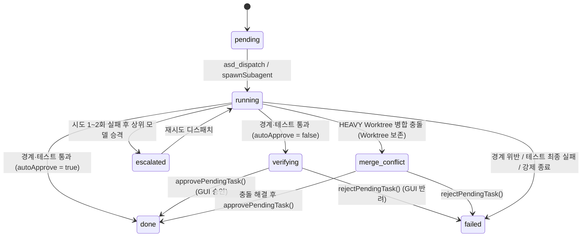

# ASD GUI & Multi-Harness Session Management — Complete Architecture & Implementation Specification

> **문서 목적**: 이 문서는 `asd-multiagent`(CLI 및 코어 오케스트레이션 엔진)를 코드 중복 0%로 재사용하여 5대 AI 코딩 하네스(`claude-code`, `opencode`, `codex`, `antigravity`, `cursor`)의 메인 세션·서브에이전트 세션·대시보드·Git Worktree 승인 게이트를 통합 제어하는 **`asd-gui` (`GUI-web` 브라우저 버전 + `GUI-app` 데스크톱 앱 버전)** 프로젝트의 **완결형 설계 명세서**입니다.
>
> 본 문서만 읽고도 추가 질문이나 모호함 없이 `asd-gui` 전체를 설계·구현·연동할 수 있도록 모든 디렉토리 구조, 데이터 스키마, SQLite 테이블 규격, `asd-multiagent` 공개 API 시그니처, 5대 하네스 CLI/PTY 명령어 매트릭스, 백엔드 REST/WebSocket 프로토콜, 프론트엔드 UI 레이아웃 및 6대 실행 시나리오를 상세히 기술합니다.

---

## 목차

1. [아키텍처 배경 및 핵심 의사결정 (ADR)](#1-아키텍처-배경-및-핵심-의사결정-adr)
2. [저장소 분리 및 모노/멀티 패키지 구조](#2-저장소-분리-및-모노멀티-패키지-구조)
3. [파일 시스템 및 SQLite 데이터 스키마 명세](#3-파일-시스템-및-sqlite-데이터-스키마-명세)
4. [`asd-multiagent` 패키지 Export 및 코어 API 레퍼런스](#4-asd-multiagent-패키지-export-및-코어-api-레퍼런스)
5. [5대 하네스 세션 ID 추출 및 CLI/PTY 명령어 매트릭스](#5-5대-하네스-세션-id-추출-및-clipty-명령어-매트릭스)
6. [`asd-gui` 백엔드 (`src/server`) 상세 명세 (REST API + WebSocket + `node-pty`)](#6-asd-gui-백엔드-srcserver-상세-명세-rest-api--websocket--node-pty)
7. [`asd-gui` 프론트엔드 (`src/web`) 화면 레이아웃 및 상태 관리 명세](#7-asd-gui-프론트엔드-srcweb-화면-레이아웃-및-상태-관리-명세)
8. [`asd-gui` 데스크톱 앱 (`src/app`) Electron 래퍼 명세](#8-asd-gui-데스크톱-앱-srcapp-electron-래퍼-명세)
9. [6대 핵심 엔드투엔드(E2E) 워크플로우 시나리오](#9-6대-핵심-엔드투엔드e2e-워크플로우-시나리오)
10. [`asd-multiagent` 내 선행 구현 완료 체크리스트](#10-asd-multiagent-내-선행-구현-완료-체크리스트)

---

## 1. 아키텍처 배경 및 핵심 의사결정 (ADR)

### ADR-01: 코어/CLI(`asd-multiagent`)와 GUI(`asd-gui`)의 저장소 분리 및 코어 100% 재사용
* **결정**:
  1. `asd-multiagent`는 외부 런타임 패키지 의존성이 전혀 없는 **Zero-dependency(`"dependencies": {}`)** 원칙을 유지하며, `package.json`의 `exports` 필드를 통해 내부 코어 모듈을 외부에 공개합니다.
  2. 새 GUI 프로젝트인 `asd-gui`는 별도의 Git 저장소(`../asd-gui`)로 생성하며, `"agent-swarm-director": "file:../asd-multiagent"`를 의존성으로 참조합니다.
  3. DB 쿼리, 라우팅 계산, 서브에이전트 스폰, 시크릿 마스킹, Git Worktree 생성/검증/병합, 세션 추적 로직은 **절대 `asd-gui`에 복사하지 않고 `agent-swarm-director`에서 import하여 호출**합니다 (코드 중복 0%).

### ADR-02: 단일 UI 코드베이스로 `GUI-web`(브라우저)과 `GUI-app`(데스크톱 앱) 동시 지원
* **결정**:
  1. `asd-gui/src/web`에 React + Vite + TypeScript + `xterm.js` 기반의 프론트엔드를 구현하고, `asd-gui/src/server`에 로컬 Node.js 서버(HTTP REST + WebSocket + `node-pty`)를 구현합니다.
  2. **`GUI-web` 모드**: 로컬 서버를 띄우고 일반 웹 브라우저(`http://127.0.0.1:4173`)로 접속하여 사용합니다.
  3. **`GUI-app` 모드**: `asd-gui/src/app`의 Electron 메인 프로세스가 백엔드(`src/server`)를 내장 실행하고 동일한 `src/web` 번들을 네이티브 데스크톱 창(`BrowserWindow`)으로 렌더링합니다.
  4. 한편 기존 `asd-multiagent`에 내장된 초경량 `asd ui`(`src/cli/dashboard.ts`)는 CLI 단독 설치 사용자를 위해 그대로 보존합니다.

### ADR-03: 별도 GUI 전용 DB 없이 프로젝트 폴더 기반 세션 로드 + 2-Tier 세션 저장 구조
* **결정**:
  1. GUI만을 위한 별도의 중앙 세션 DB를 만들지 않습니다. 사용자가 GUI에서 특정 프로젝트 폴더(`<project-root>`)를 열면 해당 프로젝트의 `<project-root>/.asd/sessions/`와 `~/.asd/state/<project-hash>/core.db`를 즉시 읽어옵니다.
  2. 최근 작업한 프로젝트 목록은 `listKnownProjects()`가 `~/.asd/state/*/core.db`의 `sessions.project_root`를 스캔하여 자동으로 구성합니다.
  3. **2-Tier 세션 분리 저장**:
     * **Tier 1 — 모든 일반 하네스 대화 (`<project>/.asd/sessions/cli-recent.json`)**:
       사용자가 `/asd` 명령 없이 일반 CLI/IDE에서 나눈 모든 대화도 훅(`PreToolUse`, `Stop`)을 통해 감지하여 단일 인덱스 파일(`cli-recent.json`)에 하네스 종류, 하네스 고유 세션 ID(`harnessSessionId`), 최근 활동 시각, **0-Token 한 줄 요약**(첫 질문 50자 또는 실행 도구+파일명)만 경량 기록합니다.
     * **Tier 2 — `/asd*` 오케스트레이션 및 GUI 메인 세션 (`<project>/.asd/sessions/<asd-id>/`)**:
       `/asd`, `/asd-plan`, `/asd-run`, `/asd-debate`, `/asd-debug` 등을 실행했거나 GUI에서 정식 시작한 세션만 `<asd-id>/` 디렉토리(`main.json` + `subagents/<sub-id>/`)와 `core.db` 행을 생성합니다.

### ADR-04: 메인 및 서브 하네스 고유 세션 ID(`harnessSessionId`) 캡처와 양방향 Resume
* **결정**:
  1. 각 하네스가 자체 관리하는 세션 ID(`session_id`, `thread_id`, `sessionID`, `conversation_id`, `chat_id`)를 **메인 에이전트(`main.json` 및 `core.db`)**와 **모든 서브 하네스(`subagents/<sub-id>/meta.json`)** 양쪽에 기록합니다.
  2. 이를 통해:
     * CLI에서 하던 대화를 GUI에서 클릭 한 번으로 이어받거나(`GUI → CLI Resume`),
     * GUI에서 실행한 메인/서브 세션을 일반 터미널 CLI에서 이어받거나(`CLI → GUI Resume`),
     * 이미 종료된 특정 서브 하네스(예: 특정 태스크 워커, 아키텍트, 토론 리뷰어)에게만 추가 프롬프트를 보내 기존 컨텍스트 그대로 후속 작업을 지시할 수 있습니다.

### ADR-05: 수동 승인 모드(`autoApprove: false`)와 실시간 Worktree Diff 게이트
* **결정**:
  1. 세션 또는 디스패치 단위로 `autoApprove: boolean` 옵션을 제공합니다 (기본값 `true`).
  2. `autoApprove: false`(수동 승인 모드)일 때는 서브 하네스가 코드 수정을 마치고 파일 경계(`allowedFiles`) 및 테스트(`verify_cmd`)를 통과하더라도 **즉시 본 브랜치에 병합/커밋하지 않고 태스크 상태를 `'verifying'`으로 전환**하며 Worktree(`.asd/wt/<turn>-<taskId>`)를 그대로 보존합니다.
  3. 사용자가 GUI Diff 뷰어(`getWorktreeDiff`)로 변경 내역을 확인한 뒤 **[승인(`approvePendingTask`)]**을 누르면 본 브랜치에 병합·정리되고(`'done'`), **[반려(`rejectPendingTask`)]**를 누르면 변경 사항이 폐기·롤백됩니다(`'failed'`).

---

## 2. 저장소 분리 및 모노/멀티 패키지 구조

```text
C:\Users\yjsjs0987\Desktop\Projects\
│
├── asd-multiagent/                          # [저장소 1] CLI & 코어 엔진 (Zero-dependency)
│   ├── package.json                         # name: "agent-swarm-director", exports 선언
│   ├── GUI_ARCHITECTURE.md                  # 본 아키텍처 및 상세 구현 명세서
│   ├── src/
│   │   ├── index.ts                         # 외부 재사용을 위한 루트 Barrel Export
│   │   ├── core/
│   │   │   ├── types.ts                     # 모든 공용 타입 및 인터페이스
│   │   │   ├── paths.ts                     # ~/.asd 및 <project>/.asd 경로 해석기
│   │   │   ├── db.ts                        # node:sqlite 기반 SqliteDriver (core.db)
│   │   │   ├── session-tracker.ts           # cli-recent.json 기록, 세션 ID 추출, 프로젝트 탐색, Resume 빌더
│   │   │   ├── spawner.ts                   # 헤드리스 서브 하네스 프로세스 스폰 및 harnessSessionId 캡처
│   │   │   ├── workspace.ts                 # Git 베이스라인, LIGHT/HEAVY 검증, 수동 승인 게이트, Worktree Diff
│   │   │   ├── router.ts                    # 4-Tier 모델 라우팅, 에스컬레이션, 교차 모델 리뷰어 선택
│   │   │   ├── config.ts                    # routing.jsonc 로더/세이버, 런타임 프로브 캐시
│   │   │   ├── plan.ts                      # PLAN.md 파서/렌더러/양방향 동기화, 진행 보드 생성
│   │   │   └── policy.ts                    # PreToolUse / Stop 훅 평가기, 시크릿 마스킹
│   │   ├── adapters/
│   │   │   ├── index.ts                     # 5대 어댑터 레지스트리 (getAdapter, getAllAdapters)
│   │   │   ├── claude-code.ts               # Claude Code CLI 어댑터
│   │   │   ├── opencode.ts                  # OpenCode CLI 어댑터
│   │   │   ├── codex.ts                     # Codex CLI 어댑터
│   │   │   ├── antigravity.ts               # Antigravity (agy) 어댑터
│   │   │   └── cursor.ts                    # Cursor (agent) 어댑터
│   │   ├── mcp/
│   │   │   └── server.ts                    # asd_plan, asd_dispatch, asd_verify, asd_debate 핸들러
│   │   └── cli/
│   │       ├── index.ts                     # CLI 엔트리 (init, sync, status, doctor, clean, ui, hook, mcp)
│   │       └── dashboard.ts                 # collectDashboardSnapshot, runSubagentControlAction, 내장 경량 UI
│   └── tests/
│       └── gui-prerequisites.test.ts        # GUI 선행 기능 통합 테스트
│
└── asd-gui/                                 # [저장소 2] 통합 GUI 애플리케이션 (별도 Git 저장소)
    ├── package.json                         # "agent-swarm-director": "file:../asd-multiagent"
    ├── tsconfig.json
    ├── vite.config.ts
    ├── src/
    │   ├── shared/
    │   │   └── protocol.ts                  # Server ↔ Web 간 REST/WebSocket 메시지 타입 정의
    │   ├── server/                          # Node.js 백엔드 서버 (GUI-web & GUI-app 공용)
    │   │   ├── index.ts                     # HTTP + WebSocket 서버 부트스트랩
    │   │   ├── routes/
    │   │   │   ├── projects.ts              # 프로젝트 목록, 열기, 모델 탐색, routing.jsonc API
    │   │   │   ├── sessions.ts              # 새 세션 생성, cli-recent.json 조회, /asd 세션 조회, 서브에이전트 제어/Resume
    │   │   │   └── tasks.ts                 # PLAN.md 동기화, 태스크 디스패치, Worktree Diff, 승인/반려 API
    │   │   ├── pty/
    │   │   │   └── pty-manager.ts           # node-pty 멀티플렉서 (온디맨드 CLI 터미널 세션 관리)
    │   │   └── watcher/
    │   │       └── state-watcher.ts         # core.db(state_version) 디바운스 및 output.log 증분 브로드캐스터
    │   ├── web/                             # React + Vite 프론트엔드 (GUI-web & GUI-app 공용)
    │   │   ├── index.html
    │   │   ├── main.tsx
    │   │   ├── App.tsx
    │   │   ├── store/
    │   │   │   └── useAsdStore.ts           # 프로젝트/세션/태스크/온디맨드 터미널/Diff 상태 스토어
    │   │   └── components/
    │   │       ├── Sidebar/                 # 프로젝트 스위처 + [+ 새 세션] + /asd 세션 트리 + 일반 CLI 최근 대화 목록
    │   │       ├── PlanBoard/               # [메인 뷰] GUI 프롬프트 입력 + PLAN.md 칸반/웨이브 보드 & 마크다운 에디터
    │   │       ├── SubagentInspector/       # 서브 하네스 프롬프트/실시간 로그/Headless Resume/온디맨드 PTY 열기
    │   │       ├── WorktreeDiffModal/       # verifying 상태 태스크의 Git Diff 비교 및 [승인]/[반려] 게이트
    │   │       ├── RoutingConfigPanel/      # 글로벌/프로젝트 routing.jsonc 시각적 편집기
    │   │       └── TerminalPane/            # [보조/온디맨드] 사용자가 [>_ CLI 터미널 열기] 클릭 시에만 열리는 xterm.js 뷰
    │   └── app/                             # [GUI-app 전용] Electron 데스크톱 래퍼
    │       ├── main.ts                      # 내장 src/server 기동 + BrowserWindow 생성 + 네이티브 폴더 선택 다이얼로그
    │       └── preload.ts                   # contextBridge (네이티브 폴더 피커 등 최소 IPC 노출)
```

---

## 3. 파일 시스템 및 SQLite 데이터 스키마 명세

### 3.1 프로젝트 로컬 `.asd/` 디렉토리 레이아웃

```text
<project-root>/.asd/
├── PLAN.md                                  # 현재 세션의 마크다운 계획서 (체크박스 양방향 동기화)
├── routing.jsonc                            # (선택) 해당 프로젝트 전용 라우팅 설정 오버라이드
├── wt/                                      # HEAVY 트랙 태스크용 Git Worktree 디렉토리
│   └── <turn>-<taskId>/                     # 예: .asd/wt/1-T1.1/ (verifying 대기 중일 때 보존됨)
└── sessions/
    ├── cli-recent.json                      # [Tier 1] 일반 대화를 포함한 모든 하네스 CLI 세션 인덱스 (최대 50건)
    └── <asd-session-id>/                    # [Tier 2] /asd 오케스트레이션 또는 GUI에서 시작된 정식 세션 폴더
        ├── main.json                        # 메인 에이전트 메타데이터 (harnessSessionId, autoApprove 등)
        ├── summary.md                       # 세션 완료 시 생성되는 요약 마크다운
        └── subagents/                       # 해당 메인 세션이 호출한 모든 서브 하네스 실행 기록
            └── <sub-session-id>/
                ├── meta.json                # 서브 하네스 메타데이터 (harnessSessionId, pid, status 등)
                ├── prompt.md                # 서브 하네스에 전달된 프롬프트 원문 (시크릿 마스킹됨)
                └── output.log               # 서브 하네스 실시간 stdout/stderr 로그 (시크릿 마스킹됨)
```

### 3.2 `<project>/.asd/sessions/cli-recent.json` 스키마 (`{ sessions: CliRecentSessionEntry[] }`)
일반 CLI 대화(비-ASD 세션)와 ASD 연결 세션을 모두 기록하는 JSON 파일입니다 (`readCliRecentSessions` 호출 시 `CliRecentSessionEntry[]` 배열 반환). `updatedAt` 내림차순으로 정렬되며 최대 100개 항목을 유지합니다.

```json
{
  "sessions": [
    {
      "harnessSessionId": "claude-conv-98a7b6c5",
      "harness": "claude-code",
      "projectRoot": "C:/Users/yjsjs0987/Desktop/Projects/my-app",
      "summary": "로그인 API에서 JWT 만료 시간 처리 버그 수정해줘",
      "startedAt": 1730419800000,
      "updatedAt": 1730419950000,
      "asdSessionId": "asd-20261101-01",
      "model": "claude-opus-4-6",
      "transcriptPath": "C:/Users/yjsjs0987/.claude/projects/.../claude-conv-98a7b6c5.jsonl"
    },
    {
      "harnessSessionId": "codex-thread-112233",
      "harness": "codex",
      "projectRoot": "C:/Users/yjsjs0987/Desktop/Projects/my-app",
      "summary": "Edit: README.md",
      "startedAt": 1730419500000,
      "updatedAt": 1730419570000
    }
  ]
}
```

* **필드 설명**:
  * `harnessSessionId` (`string`, PK 역할): 하네스 네이티브 세션 ID (`session_id`, `thread_id`, `sessionID`, `conversation_id`, `chat_id`)
  * `harness` (`HarnessId`): `'claude-code' | 'opencode' | 'codex' | 'antigravity' | 'cursor'`
  * `projectRoot` (`string`): 프로젝트 루트 절대 경로
  * `summary` (`string`): LLM 호출 없이(0-Token) 추출한 한 줄 요약 (사용자 첫 프롬프트 50자 또는 `<ToolName>: <FileBasename>`)
  * `startedAt` / `updatedAt` (`number`): Unix 밀리초 타임스탬프
  * `asdSessionId` (`string`, 선택): 이 CLI 대화가 정식 `/asd` 세션으로 승격/연결된 경우 해당 `<asd-session-id>`
  * `model` (`string`, 선택): 감지된 모델 ID
  * `transcriptPath` (`string`, 선택): 하네스 로컬 트랜스크립트 파일 경로

### 3.3 `<project>/.asd/sessions/<asd-id>/main.json` 스키마 (`MainSessionMeta`)

```json
{
  "sessionId": "asd-20261101-01",
  "roleType": "main",
  "harness": "claude-code",
  "model": "claude-opus-4-6",
  "harnessSessionId": "claude-conv-98a7b6c5",
  "role": "director",
  "phase": "executing",
  "pid": 18420,
  "startedAt": "2026-11-01T00:10:00.000Z",
  "autoApprove": false,
  "memo": "JWT 만료 버그 수정 및 인증 미들웨어 리팩터링"
}
```

### 3.4 `<project>/.asd/sessions/<asd-id>/subagents/<sub-id>/meta.json` 스키마 (`SubagentSessionMeta`)

```json
{
  "subSessionId": "sub-1730419800000-a1b2c3",
  "parentSessionId": "asd-20261101-01",
  "taskId": "T1.1",
  "role": "worker",
  "harness": "codex",
  "model": "gpt-5.4",
  "harnessSessionId": "thread_01JBM9X7Z8...",
  "pid": 24812,
  "worktreePath": "C:/Users/yjsjs0987/Desktop/Projects/my-app/.asd/wt/1-T1.1",
  "startedAt": 1730419860000,
  "finishedAt": 1730419965000,
  "durationMs": 105000,
  "status": "done"
}
```

### 3.5 글로벌 SQLite 데이터베이스 (`~/.asd/state/<project-hash>/core.db`) 스키마

`resolveAsdPaths(projectRoot, homeDir)`를 호출하면 `projectRoot`의 정규화된 경로 해시(8자리 SHA-256)를 기반으로 `~/.asd/state/<hash>/core.db` 경로가 결정됩니다.

#### 1) `sessions` 테이블 (`SessionRow`)
| 컬럼명 | 타입 | 기본값 | 설명 |
|---|---|---|---|
| `session_id` | `TEXT PRIMARY KEY` | - | ASD 세션 고유 ID (`<asd-id>`) |
| `project_root` | `TEXT NOT NULL` | - | 프로젝트 루트 절대 경로 |
| `main_harness` | `TEXT NOT NULL` | - | 메인 하네스 ID (`claude-code` 등) |
| `main_model` | `TEXT` | `NULL` | 메인 하네스 모델명 |
| `harness_session_id` | `TEXT` | `NULL` | 메인 하네스의 네이티브 세션 ID (CLI↔GUI Resume용) |
| `auto_approve` | `INTEGER NOT NULL` | `1` | `1`: 자동 병합/커밋, `0`: 테스트 통과 후 `'verifying'` 상태에서 수동 승인 대기 |
| `main_pid` | `INTEGER` | `NULL` | 메인 에이전트 프로세스 PID |
| `phase` | `TEXT NOT NULL` | `'planning'` | `'planning' \| 'debating' \| 'executing' \| 'verifying' \| 'done' \| 'failed'` |
| `base_branch` | `TEXT` | `NULL` | 시작 당시 Git 브랜치명 |
| `base_sha` | `TEXT` | `NULL` | 시작 당시 베이스라인 커밋 SHA |
| `stashed_work_sha` | `TEXT` | `NULL` | `prepareBaseline`이 자동 스태시한 경우 해당 SHA |
| `state_version` | `INTEGER NOT NULL` | `1` | 상태 변경 시마다 단조 증가하는 버전 카운터 (폴링/워처 최적화용) |
| `no_progress_count` | `INTEGER NOT NULL` | `0` | Stop 훅 3-Strike 서킷 브레이커 카운터 |
| `last_incomplete_hash` | `TEXT` | `NULL` | 미완료 태스크 해시 |
| `memo` | `TEXT` | `NULL` | 세션 한 줄 메모 |
| `created_at` | `INTEGER NOT NULL` | - | Unix 밀리초 생성 시각 |
| `updated_at` | `INTEGER NOT NULL` | - | Unix 밀리초 갱신 시각 |

#### 2) `tasks` 테이블 (`TaskRow`)
| 컬럼명 | 타입 | 기본값 | 설명 |
|---|---|---|---|
| `session_id` | `TEXT NOT NULL` | - | FK (`sessions.session_id`) |
| `task_id` | `TEXT NOT NULL` | - | 태스크 ID (예: `T1.1`, 복합 PK `(session_id, task_id)`) |
| `turn` | `INTEGER NOT NULL` | `1` | 실행 웨이브(Turn) 번호 |
| `title` | `TEXT NOT NULL` | - | 태스크 제목 |
| `track` | `TEXT NOT NULL` | `'LIGHT'` | `'LIGHT'`(인플레이스 체크포인트) 또는 `'HEAVY'`(격리 Git Worktree) |
| `role` | `TEXT NOT NULL` | `'worker'` | 할당된 에이전트 역할 (`planner \| architect \| worker \| scout \| critic`) |
| `category` | `TEXT` | `NULL` | 도메인 카테고리 (`visual-ui \| design \| research \| writing \| general`) |
| `difficulty` | `TEXT` | `'medium'` | `'low' \| 'medium' \| 'high'` |
| `harness_override` | `TEXT` | `NULL` | 명시적 핀 오버라이드 (`@codex`, `@claude` 등) |
| `assigned_harness` | `TEXT` | `NULL` | 라우터가 배정한 하네스 ID |
| `assigned_model` | `TEXT` | `NULL` | 라우터가 배정한 모델명 |
| `thinking_effort` | `TEXT` | `NULL` | 추론 강도 (`low \| medium \| high`) |
| `target_files_json` | `TEXT NOT NULL` | `'[]'` | 수정 허용 파일 글롭 배열 JSON 문자열 (`allowedFiles`) |
| `acceptance` | `TEXT` | `NULL` | 인수 조건 설명 |
| `verify_cmd` | `TEXT` | `NULL` | 검증 명령어 (미지정 시 자동 추론) |
| `depends_on_json` | `TEXT NOT NULL` | `'[]'` | 선행 태스크 ID 배열 JSON 문자열 |
| `status` | `TEXT NOT NULL` | `'pending'` | `'pending' \| 'running' \| 'verifying' \| 'done' \| 'escalated' \| 'failed' \| 'merge_conflict'` |
| `attempts` | `INTEGER NOT NULL` | `0` | 시도 횟수 |
| `sub_session_id` | `TEXT` | `NULL` | 실행된 서브에이전트 세션 ID (`<sub-id>`) |
| `worktree_path` | `TEXT` | `NULL` | HEAVY 트랙 Worktree 절대 경로 |
| `commit_sha` | `TEXT` | `NULL` | 완료 커밋/병합 SHA |
| `duration_ms` | `INTEGER` | `NULL` | 소요 시간 (ms) |
| `is_cross_scope` | `INTEGER NOT NULL` | `0` | 교차 범위 자동 생성 태스크 여부 (`0` 또는 `1`) |

#### 3) 태스크 상태 전이도 (Task Status State Machine)


---

## 4. `asd-multiagent` 패키지 Export 및 코어 API 레퍼런스

`asd-gui` 백엔드는 `agent-swarm-director`(또는 하위 경로)에서 아래 함수들을 직접 import하여 사용합니다.

### 4.1 `package.json` Subpath Exports 매핑
| Import 경로 | 실제 소스 파일 | 주요 용도 |
|---|---|---|
| `agent-swarm-director` | `./src/index.ts` | 모든 공개 API 통합 Barrel Export (권장) |
| `agent-swarm-director/core/types.ts` | `./src/core/types.ts` | 모든 TypeScript 인터페이스 및 타입 |
| `agent-swarm-director/core/config.ts` | `./src/core/config.ts` | `resolveAsdPaths`, `loadRoutingConfig`, `probeRuntimeCapabilities` |
| `agent-swarm-director/core/db.ts` | `./src/core/db.ts` | `openProjectDb`, `SqliteDriver`, `SessionRow`, `TaskRow`, `DebateRow` |
| `agent-swarm-director/core/session-tracker.ts` | `./src/core/session-tracker.ts` | `cli-recent.json` 조회/기록, 프로젝트 스캔, Resume 명령어 빌더 |
| `agent-swarm-director/core/spawner.ts` | `./src/core/spawner.ts` | `spawnSubagent`, `killProcessTree` |
| `agent-swarm-director/core/workspace.ts` | `./src/core/workspace.ts` | `getWorktreeDiff`, `approvePendingTask`, `rejectPendingTask` 등 |
| `agent-swarm-director/core/router.ts` | `./src/core/router.ts` | `resolveTaskRoute`, `escalateTaskRoute`, `selectDiverseReviewer` |
| `agent-swarm-director/core/render.ts` (`./core/plan`) | `./src/core/render.ts` | `parsePlanMd`, `renderPlanMd`, `syncPlanFromMd`, `renderProgressBoard`, `renderSessionSummaryMd` |
| `agent-swarm-director/cli/dashboard.ts` | `./src/cli/dashboard.ts` | `collectDashboardSnapshot`, `discoverHarnessModels`, `saveSessionMemo`, `saveProjectRoutingConfig`, `runSubagentControlAction` |
| `agent-swarm-director/mcp/server.ts` | `./src/mcp/server.ts` | `AsdMcpServer`, `handlePlan`, `handleDispatch`, `handleVerify`, `handleDebate` |

### 4.2 `asd-gui`가 호출할 핵심 함수 시그니처 상세

#### (1) 멀티 프로젝트 및 CLI 세션 트래커 (`src/core/session-tracker.ts`)
```ts
// ~/.asd/state/*/core.db를 스캔하여 ASD 이력이 있는 모든 프로젝트 목록 반환
export function listKnownProjects(options?: {
  homeDir?: string;
}): KnownProjectSummary[];

// <projectRoot>/.asd/sessions/cli-recent.json에서 최근 CLI 대화 목록 읽기
export function readCliRecentSessions(
  projectRoot: string
): CliRecentSessionEntry[];

// 특정 CLI 세션을 cli-recent.json에 추가/갱신
export function recordCliRecentSession(
  projectRoot: string,
  input: {
    harnessSessionId: string;
    harness: HarnessId;
    model?: string | null;
    summary?: string;
    transcriptPath?: string | null;
    asdSessionId?: string | null;
  },
  options?: { forceCreateDir?: boolean }
): CliRecentSessionEntry | null;

// 일반 CLI 하네스 세션 ID를 정식 ASD 세션(core.db + main.json + cli-recent.json)에 연결
export function linkHarnessSessionToAsdSession(options: {
  projectRoot: string;
  homeDir?: string;
  asdSessionId: string;
  harness?: HarnessId;
  harnessSessionId?: string | null;
  mainModel?: string | null;
  autoApprove?: boolean;
  db?: SqliteDriver;
}): { harnessSessionId: string | null; mainModel: string | null };

// 헤드리스(단발성 추가 프롬프트 주입) Resume 명령어 생성 (위치 인자 및 옵션 객체 양방향 지원)
export function buildResumeHarnessCommand(
  harnessOrOptions: HarnessId | {
    harness: HarnessId;
    harnessSessionId: string;
    prompt: string;
    model?: string | null;
    thinkingEffort?: string | null;
    reasoningEffort?: string | null;
    cwd?: string;
    env?: Record<string, string>;
  },
  harnessSessionId?: string,
  prompt?: string,
  model?: string | null,
  thinkingEffort?: string | null
): { command: string; args: string[] };

// GUI xterm.js + node-pty 대화형 터미널 접속용 Resume 명령어 생성 (위치 인자 및 옵션 객체 양방향 지원)
export function buildInteractiveResumeHarnessCommand(
  harnessOrOptions: HarnessId | {
    harness: HarnessId;
    harnessSessionId?: string | null; // 생략 시 새 대화형 세션 시작
    model?: string | null;
  },
  harnessSessionId?: string | null,
  model?: string | null
): { command: string; args: string[]; cliString: string };
```

#### (2) 수동 승인 게이트 및 Git Worktree Diff (`src/core/workspace.ts`)
```ts
// 특정 태스크(또는 Worktree 경로)의 변경 파일 목록, git status --short, 전체 통합 Diff(신규 untracked 파일 포함) 반환
export function getWorktreeDiff(
  projectRoot: string,
  options?: {
    wtPath?: string;
    turn?: number;
    taskId?: string;
  }
): WorktreeDiffSnapshot;

// 'verifying' 상태(수동 승인 대기)인 태스크를 승인하여 본 브랜치에 병합(HEAVY) 또는 체크포인트 커밋(LIGHT) 수행
export async function approvePendingTask(options: {
  projectRoot: string;
  sessionId: string;
  taskId: string;
  db: SqliteDriver;
  smokeCmd?: string | null;
}): Promise<{
  ok: boolean;
  status: TaskStatus;
  commitSha?: string;
  changedFiles?: string[];
  error?: string;
}>;

// 'verifying' 또는 'merge_conflict' 상태인 태스크를 반려하여 Worktree 삭제(HEAVY) 또는 git checkout/clean 롤백(LIGHT) 후 'failed' 처리
export function rejectPendingTask(options: {
  projectRoot: string;
  sessionId: string;
  taskId: string;
  db: SqliteDriver;
}): {
  ok: boolean;
  status: TaskStatus;
};
```

#### (3) 통합 대시보드 스냅샷, 모델 탐색 및 서브에이전트 제어 (`src/cli/dashboard.ts`)
```ts
// 프로젝트의 현재 세션, 모든 세션 목록, 태스크, 디베이트, 서브에이전트 로그(harnessSessionId 포함),
// cliRecentSessions, routingConfig, availableModels, harnesses 상태를 한 번에 수집
export async function collectDashboardSnapshot(options?: {
  projectRoot?: string;
  homeDir?: string;
}): Promise<DashboardSnapshot>; // (DashboardStateSnapshot 별칭 호환)

// 5대 하네스의 실제 사용 가능한 모델 목록 동적 탐색
export async function discoverHarnessModels(options?: {
  projectRoot?: string;
  homeDir?: string;
  forceRefresh?: boolean;
  skipCliSpawn?: boolean;
}): Promise<HarnessModelCatalog>;

// 프로젝트 로컬 routing.jsonc 저장 또는 초기화
export function saveProjectRoutingConfig(options: {
  projectRoot: string;
  homeDir?: string;
  action?: "save" | "reset";
  routingConfig?: RoutingConfig;
}): {
  ok: boolean;
  hasLocalRouting: boolean;
  localRoutingPath: string;
  routingConfig: RoutingConfig;
};

// 실행 중인 서브에이전트 강제 종료("kill"), 재실행("retry"), 폴백("fallback"), 커스텀("custom"),
// 또는 저장된 harnessSessionId로 후속 프롬프트 주입("resume")
export async function runSubagentControlAction(options: {
  projectRoot: string;
  homeDir?: string;
  sessionId: string;
  subSessionId: string;
  action: "kill" | "retry" | "fallback" | "custom" | "resume";
  prompt?: string; // action === "resume"일 때 전달할 후속 지시문
  harness?: HarnessId;
  model?: string;
  waitForCompletion?: boolean;
}): Promise<{
  ok: boolean;
  action: string;
  sessionId: string;
  subSessionId: string;
  newSubSessionId?: string;
  harness?: string;
  model?: string;
  status: string;
}>;
```

---

## 5. 5대 하네스 세션 ID 추출 및 CLI/PTY 명령어 매트릭스

`asd-multiagent`의 5대 어댑터(`src/adapters/*.ts`)와 `session-tracker.ts`에 구현된 하네스별 명령어 규격입니다.

| 하네스 (`HarnessId`) | 바이너리 | 1) 신규 헤드리스 실행 (`buildSpawnCommand`) | 2) 헤드리스 세션 이어하기 (`buildResumeCommand`) | 3) GUI `xterm.js` 대화형 PTY 실행/접속 (`buildInteractiveResumeCommand`) | JSON 출력 내 세션 ID 키 |
|---|---|---|---|---|---|
| `claude-code` | `claude` | `claude -p "<prompt>" --output-format json --model <model>` | `claude --resume <harnessSessionId> -p "<prompt>" --output-format json [--model <model>]` | 이어하기: `claude --resume <harnessSessionId>`<br>신규: `claude [--model <model>]` | `session_id`, `sessionId`, `conversation_id` |
| `opencode` | `opencode` | `opencode run "<prompt>" --format json --model <model>` | `opencode run "<prompt>" --session <harnessSessionId> --format json [--model <model>]` | 이어하기: `opencode -s <harnessSessionId>`<br>신규: `opencode [-m <model>]` | `sessionID`, `session_id`, `sessionId` |
| `codex` | `codex` | `codex exec "<prompt>" --json -m <model> -c model_reasoning_effort="<effort>"` | `codex exec resume <harnessSessionId> "<prompt>" --json [-m <model>]` | 이어하기: `codex resume <harnessSessionId>`<br>신규: `codex [-m <model>]` | `thread_id`, `threadId`, `session_id`, `conversation_id` |
| `antigravity` | `agy` | `agy -p "<prompt>" --output-format json --model <model> --effort <effort>` | `agy --resume <harnessSessionId> -p "<prompt>" --output-format json [--model <model>]` | 이어하기: `agy --resume <harnessSessionId>`<br>신규: `agy [--model <model>]` | `conversation_id`, `conversationId`, `session_id` |
| `cursor` | `agent` | `agent -p "<prompt>" --force --output-format json --model <model>` | `agent --resume <harnessSessionId> -p "<prompt>" --force --output-format json [--model <model>]` | 이어하기: `agent --resume <harnessSessionId>`<br>신규: `agent [--model <model>]` | `chat_id`, `chatId`, `session_id`, `conversation_id` |

### 세션 ID 캡처 경로 2가지
1. **메인 하네스(CLI/IDE 대화 중)**:
   * 각 하네스가 도구를 호출할 때(`PreToolUse`) 또는 응답을 마칠 때(`Stop`) 실행되는 `asd hook pre-tool-use --harness <h>` / `asd hook stop --harness <h>`가 stdin JSON 페이로드에서 `session_id` / `thread_id` / `sessionID` / `conversation_id` 및 `transcript_path`를 추출합니다.
   * 추출 즉시 `<project>/.asd/sessions/cli-recent.json`을 갱신하며, 현재 프로젝트에 활성 `/asd` 세션이 존재하면 `core.db`(`sessions.harness_session_id`)와 `<project>/.asd/sessions/<asd-id>/main.json`에 자동으로 연결합니다.
2. **서브 하네스(`spawnSubagent` 실행 중)**:
   * `spawner.ts`가 서브 프로세스의 stdout/stderr 스트림을 줄 단위로 파싱(`extractHarnessSessionIdFromOutput`)하여 하네스 고유 세션 ID가 출력되는 즉시 메모리에 캡처하고, `<project>/.asd/sessions/<asd-id>/subagents/<sub-id>/meta.json`의 `harnessSessionId` 필드에 기록합니다.

---

## 6. `asd-gui` 백엔드 (`src/server`) 상세 명세 (REST API + WebSocket + `node-pty`)

`asd-gui`의 백엔드 서버는 기본 포트 `4173`(설정 가능)에서 구동되며, 정적 프론트엔드 번들(`src/web/dist`) 서빙과 아래 REST API 및 WebSocket 엔드포인트를 제공합니다.

### 6.1 HTTP REST API 엔드포인트 명세

#### 1) 프로젝트 관리 (`/api/projects`)
| 메서드 & 경로 | 요청 바디 / 쿼리 | 내부 호출 코어 함수 | 응답 데이터 |
|---|---|---|---|
| `GET /api/projects` | - | `listKnownProjects()` | `{ projects: KnownProjectSummary[] }` |
| `GET /api/projects/browse-dirs` | `?dir=<path>` | `fs.readdirSync(dir, { withFileTypes: true })` (브라우저 `GUI-web` 폴더 선택용) | `{ currentDir: string, parentDir: string \| null, directories: string[] }` |
| `POST /api/projects/open` | `{ projectRoot: string }` | `resolveAsdPaths(projectRoot)`, `collectDashboardSnapshot({ projectRoot })` | `DashboardSnapshot` |
| `GET /api/projects/models` | `?projectRoot=<path>&refresh=0\|1` | `discoverHarnessModels({ projectRoot, forceRefresh })` | `{ models: HarnessModelCatalog }` |
| `GET /api/projects/routing` | `?projectRoot=<path>` | `loadRoutingConfig(projectRoot)` | `{ config: RoutingConfig, hasLocalRouting: boolean }` |
| `PUT /api/projects/routing` | `{ projectRoot, action?: "save"\|"reset", routingConfig?: RoutingConfig }` | `saveProjectRoutingConfig({ projectRoot, action, routingConfig })` | `{ ok: true, hasLocalRouting, localRoutingPath, routingConfig }` |

#### 2) 세션 & 서브에이전트 관리 (`/api/sessions`)
| 메서드 & 경로 | 요청 바디 / 쿼리 | 내부 호출 코어 함수 | 응답 데이터 |
|---|---|---|---|
| `GET /api/sessions/state` | `?projectRoot=<path>` | `collectDashboardSnapshot({ projectRoot })` | `DashboardSnapshot` (내부에 `sessions`, `cliRecentSessions`, `subagentLogs`, `allTasks`, `allDebates` 모두 포함) |
| `POST /api/sessions/create` | `{ projectRoot, harness, model?, autoApprove?, memo? }` | `openProjectDb().createOrGetSession(...)`, `linkHarnessSessionToAsdSession(...)` | `{ ok: true, sessionId, harness, model, autoApprove }` |
| `POST /api/sessions/prompt` | `{ projectRoot, sessionId, prompt, harness?, model? }` | `buildResumeHarnessCommand` / `getAdapter().buildSpawnCommand` + `spawnSubagent` (GUI 입력창에서 메인 하네스에 직접 지시 전송·실행) | `{ ok: true, status: "running", sessionId, subSessionId }` |
| `POST /api/sessions/memo` | `{ projectRoot, sessionId, memo }` | `saveSessionMemo({ projectRoot, sessionId, memo })` | `{ ok: true, sessionId, memo }` |
| `POST /api/sessions/plan` | `{ projectRoot, sessionId?, harness, mainModel?, harnessSessionId?, autoApprove?, tasks }` | `handlePlan(input, { projectRoot })` | `AsdPlanOutput` |
| `POST /api/sessions/link-cli` | `{ projectRoot, asdSessionId, harness, harnessSessionId, mainModel?, autoApprove? }` | `linkHarnessSessionToAsdSession(...)` | `{ ok: true, harnessSessionId, mainModel }` |
| `POST /api/sessions/subagent-action` | `{ projectRoot, sessionId, subSessionId, action: "kill"\|"retry"\|"fallback"\|"custom"\|"resume", prompt?, harness?, model? }` | `runSubagentControlAction(...)` (비동기 Fire-and-Forget 기본) | `{ ok, action, sessionId, subSessionId, newSubSessionId?, harness?, model?, status }` |
| `POST /api/sessions/debate` | `{ projectRoot, sessionId?, taskId?, topic, proposal, files?, includeDiff?, harness? }` | `handleDebate(input, { projectRoot })` (비동기 백그라운드 실행, 진행상황은 WebSocket 브로드캐스트) | `{ ok: true, status: "running", sessionId }` |

#### 3) 태스크 실행 및 수동 승인 게이트 (`/api/tasks`)
| 메서드 & 경로 | 요청 바디 / 쿼리 | 내부 호출 코어 함수 | 응답 데이터 |
|---|---|---|---|
| `POST /api/tasks/dispatch` | `{ projectRoot, sessionId, turn?, taskIds?, mode?: "parallel_spawn"\|"claim_only", autoApprove? }` | `handleDispatch(input, { projectRoot })` (`parallel_spawn`은 비동기 백그라운드 실행 후 WebSocket으로 실시간 상태 푸시, `claim_only`는 즉시 반환) | `{ ok: true, status: "running", sessionId, turn }` (또는 `claim_only` 시 즉시 `AsdDispatchOutput`) |
| `GET /api/tasks/diff` | `?projectRoot=<path>&sessionId=<id>&taskId=<tid>` | `getWorktreeDiff(projectRoot, { wtPath, turn, taskId })` | `WorktreeDiffSnapshot` (`changedFiles`, `statusShort`, `diff`) |
| `POST /api/tasks/approve` | `{ projectRoot, sessionId, taskId, smokeCmd? }` | `ptyManager.closeTabsInPath(wtPath)`(Windows `EBUSY` 잠금 해제) 후 `approvePendingTask({ projectRoot, sessionId, taskId, db, smokeCmd })` | `{ ok, status: "done", commitSha, changedFiles }` |
| `POST /api/tasks/reject` | `{ projectRoot, sessionId, taskId }` | `ptyManager.closeTabsInPath(wtPath)`(Windows `EBUSY` 잠금 해제) 후 `rejectPendingTask({ projectRoot, sessionId, taskId, db })` | `{ ok, status: "failed" }` |
| `GET /api/tasks/plan-md` | `?projectRoot=<path>` | `fs.readFileSync(<project>/.asd/PLAN.md)` | `{ content: string }` |
| `PUT /api/tasks/plan-md` | `{ projectRoot, sessionId, content: string }` | `fs.writeFileSync` + `syncPlanFromMd(db, sessionId, planPath)` | `PlanSyncResult` |

### 6.2 WebSocket, `state-watcher.ts` 디바운스, 보안 및 `node-pty` 실시간 멀티플렉싱 프로토콜 (`/ws`)

단일 WebSocket 연결(`ws://127.0.0.1:4173/ws`)을 통해 **1) 대시보드 상태 실시간 푸시(300ms 디바운스)**, **2) 서브에이전트 `output.log` 증분 스트리밍**, **3) 온디맨드 대화형 PTY 터미널 입출력**을 처리합니다.

* **`state-watcher.ts` 성능 최적화 및 SQLite WAL 감시 규칙**:
  1. `collectDashboardSnapshot()`은 모든 Worktree에 대해 `git status --short`를 실행하므로, 서브에이전트의 `output.log`나 `.tmp` 임시 파일 변경 이벤트에서는 **절대 전체 스냅샷을 재계산하지 않습니다**.
  2. SQLite가 WAL 모드(`core.db-wal`)로 동작하며 `updateTaskStatus`/`recordTaskVerified`는 `state_version`이 아닌 `sessions.updated_at` 및 `tasks.status`를 갱신하므로, `~/.asd/state/<hash>/`(`core.db`, `core.db-wal`), `main.json`, `meta.json`, `cli-recent.json`, `PLAN.md` 변경 시 **300ms Trailing Debounce**를 거쳐(`updated_at` 및 태스크 상태 다이제스트 비교 후) `state_updated`를 브로드캐스트합니다.
  3. 실행 중인 서브에이전트의 `output.log`에 추가되는 바이트는 `subagent_log_chunk` 메시지로 가볍게 스트리밍합니다.
* **보안 및 Windows 호환성 규칙**:
  1. **Strict Localhost Origin 검증**: 외부 웹사이트의 Cross-Site WebSocket Hijacking(CSWSH)을 차단하기 위해 `/ws` 및 `/api/*`는 `127.0.0.1` / `localhost` Origin만 허용합니다.
  2. **Windows `.cmd` Shim 및 `node-pty` 안전 폴백**: `pty-manager.ts`는 `resolveSpawnCommand`를 사용해 Windows 글로벌 npm shim(`claude.cmd`, `codex.cmd` 등)을 안전하게 실행하며, `node-pty` 네이티브 모듈을 사용할 수 없는 환경에서는 `child_process.spawn` 폴백으로 동작합니다.

#### 클라이언트 → 서버 메시지 (`ClientWsMessage`)
```ts
type ClientWsMessage =
  // 1. 특정 프로젝트의 실시간 상태 변경 구독
  | {
      type: "subscribe_project";
      projectRoot: string;
      sessionId?: string;
    }
  // 2. 온디맨드 대화형 PTY 터미널 탭 생성 (사용자가 [>_ CLI 터미널 열기] 클릭 시에만 실행)
  | {
      type: "pty_spawn";
      tabId: string;
      projectRoot: string;
      cwd?: string;                 // 서브에이전트 Worktree 경로 지정 가능
      harness?: HarnessId;          // 생략 시 OS 기본 셸(powershell.exe / bash / zsh)
      harnessSessionId?: string;    // 지정 시 buildInteractiveResumeHarnessCommand로 해당 세션 즉시 Resume!
      model?: string;
      cols: number;
      rows: number;
      initialInput?: string;
    }
  // 3. 터미널 키보드 입력 전송
  | {
      type: "pty_input";
      tabId: string;
      data: string;
    }
  // 4. 터미널 창 크기 조절
  | {
      type: "pty_resize";
      tabId: string;
      cols: number;
      rows: number;
    }
  // 5. 터미널 탭 종료
  | {
      type: "pty_kill";
      tabId: string;
    };
```

#### 서버 → 클라이언트 메시지 (`ServerWsMessage`)
```ts
type ServerWsMessage =
  // 1. 코어 DB(core.db-wal / updated_at) 또는 메타데이터 변경 시 300ms 디바운스 후 최신 스냅샷 푸시
  | {
      type: "state_updated";
      projectRoot: string;
      snapshot: DashboardSnapshot;
    }
  // 2. 서브에이전트 output.log 실시간 증분 스트림 (전체 스냅샷 재계산 없이 경량 전송)
  | {
      type: "subagent_log_chunk";
      projectRoot: string;
      sessionId: string;
      subSessionId: string;
      chunk: string;
    }
  // 3. PTY 터미널 출력 스트림
  | {
      type: "pty_output";
      tabId: string;
      data: string;
    }
  // 4. PTY 프로세스 종료 알림
  | {
      type: "pty_exit";
      tabId: string;
      exitCode: number;
    }
  // 5. 백그라운드 디스패치/디베이트 또는 PTY 스폰 에러 알림
  | {
      type: "error" | "pty_error";
      tabId?: string;
      sessionId?: string;
      message: string;
    };
```

---

## 7. `asd-gui` 프론트엔드 (`src/web`) 화면 레이아웃 및 상태 관리 명세

### 7.1 전체 워크스페이스 4-영역 레이아웃 (GUI-First 설계 & 온디맨드 CLI 터미널)

> **핵심 UX 원칙**:
> 1. **기본 화면은 터미널이 아닌 순수 GUI 워크스페이스(`PlanBoard` & 세션/태스크 보드)**입니다.
> 2. **1 세션 = 1 메인 하네스 원칙**: 특정 하네스(예: Claude) 사용 중 한도에 막히거나 다른 하네스를 쓰고 싶을 때는 복잡한 Handoff 레이어 없이 좌측 **`[+ 새 세션]`** 버튼으로 원하는 하네스·모델의 새 세션을 만들고 GUI에서 직접 입력하여 진행합니다.
> 3. **브라우저 내 CLI 터미널(`xterm.js`)은 필요할 때만 여는 보조(On-Demand) 뷰**입니다. 평소에는 화면을 차지하지 않으며 사용자가 명시적으로 **`[>_ CLI 터미널 열기]`** 버튼을 눌렀을 때만 열립니다.

```text
+--------------------------------------------------------------------------------------------------+
| [Top Bar] 프로젝트 선택 드롭다운 + [폴더 열기] | 현재 브랜치/커밋 | 승인모드 토글: [Auto / Manual] | 하네스 상태 |
+------------------------+----------------------------------------------+--------------------------+
| [Left Sidebar]         | [Center Main Workspace (GUI-First)]          | [Right Inspector Panel]  |
|                        |                                              |                          |
| [+ 새 세션 생성]       | 뷰 탭:                                       | 선택된 서브 하네스 상세:   |
|  (하네스 & 모델 선택)  | [📋 태스크 & PLAN 보드 (기본)] [⚙ Routing]   | - Sub ID / Role / Model  |
|                        | (필요 시 열린 경우에만: [>_ CLI: codex ×])   | - Harness Session ID     |
| 1. 정식 /asd 세션 트리  |----------------------------------------------| - PID / 소요시간 / 상태   |
|  ▼ asd-20261101-01     | [현재 세션 요약 & Turn 디스패치 컨트롤러]    |                          |
|    - Main: claude-code |  Turn 1: [T1.1 🔍 승인대기] [T1.2 ✔ 완료]    | [탭 1: 실시간 Output 로그]|
|    - [T1.1] codex (🔍) |  Turn 2: [T2.1 ⏳ 대기중]  [🚀 Turn 실행]    | [탭 2: 전달된 Prompt.md]  |
|    - [T1.2] agy   (✔) |                                              | [탭 3: Worktree Diff (🔍)]|
|                        | [PLAN.md 양방향 에디터 / 태스크 추가·수정]   |                          |
| 2. 최근 CLI 대화 목록   |----------------------------------------------| [액션 버튼바]            |
|  (cli-recent.json)     | [GUI 프롬프트 입력 & 실행 바]                | - [후속 프롬프트 Resume] |
|  • [claude] "로그인..." |  [하네스/모델 표시] [프롬프트 입력창...]     | - [>_ CLI 터미널 열기]   |
|    [승격] [>_ CLI열기] |  [프롬프트 실행] [계획 생성] [디베이트 실행] | - [재시도] / [강제종료]  |
+------------------------+----------------------------------------------+--------------------------+
```

### 7.2 주요 컴포넌트별 기능 명세

1. **좌측 사이드바 (`Sidebar`)**:
   * **상단 — `[+ 새 세션 생성]`**:
     * 사용할 하네스(`claude-code`, `codex`, `opencode`, `antigravity`, `cursor`)와 모델을 선택해 새 세션을 즉시 생성합니다. 기존 하네스가 한도(Quota)에 막혔을 때도 단순히 새 세션을 만들고 GUI에서 바로 직접 지시를 입력하면 됩니다.
   * **섹션 A — `/asd` 오케스트레이션 세션 트리 (`snapshot.sessions` + `snapshot.subagentLogs`)**:
     * 각 `/asd` 메인 세션을 클릭하면 중앙 GUI 보드에 해당 세션의 태스크 진행 현황과 서브에이전트 목록이 로드됩니다.
     * 사용자가 직접 CLI TUI 화면을 보고 싶을 때만 세션 옆 **[>_ CLI 열기]** 버튼을 눌러 온디맨드 `xterm.js` 탭을 엽니다.
   * **섹션 B — 최근 일반 CLI 대화 목록 (`snapshot.cliRecentSessions`)**:
     * `<project>/.asd/sessions/cli-recent.json`의 항목들을 표시합니다 (하네스 배지 + 0-Token 한 줄 요약 + 상대 시각).
     * **[ASD 세션으로 연결/승격]** 클릭 시 `POST /api/sessions/link-cli`를 호출하여 정식 `/asd` 세션과 연결합니다.
     * **[>_ CLI 열기]** 클릭 시에만 `buildInteractiveResumeHarnessCommand`로 온디맨드 `xterm.js` 탭을 열어 대화를 재개합니다.

2. **중앙 메인 워크스페이스 (`Center Main Workspace` — GUI 기본)**:
   * **`PLAN.md` 칸반 보드 & GUI 프롬프트 컨트롤러 (`PlanBoard` — 기본 활성 뷰)**:
     * Turn(Wave)별 태스크 카드를 상태(`pending`, `running`, `verifying`, `done`, `failed`, `merge_conflict`)에 따라 시각화하고, **[🚀 Turn 실행(Dispatch)]**, **[디베이트 실행]**, **[태스크 추가/PLAN.md 편집]**(`PUT /api/tasks/plan-md` → `syncPlanFromMd`) 및 **GUI 프롬프트 직접 입력/실행**을 모두 터미널 없이 GUI에서 수행합니다.
     * 상태가 **`verifying`**(수동 승인 대기) 또는 **`merge_conflict`**인 태스크 카드에는 주황색 **[Diff 검토 및 승인/반려]** 버튼이 활성화됩니다.
   * **라우팅 설정 탭 (`RoutingConfigPanel`)**:
     * `discoverHarnessModels`로 탐색된 실제 가용 모델 목록을 기반으로 역할별(`planner`, `architect`, `worker`, `scout`, `critic`)/카테고리별 모델 매핑과 Fallback 순서를 표 형태로 편집하고 저장합니다.
   * **온디맨드 CLI 터미널 뷰 (`TerminalPane` — 필요 시에만 열림)**:
     * 기본 상태에서는 숨겨져 있으며, 사용자가 사이드바나 인스펙터에서 **[>_ CLI 터미널 열기]**를 클릭했을 때만 보조 탭/드로어로 열려 `xterm.js` + `node-pty` 대화형 접속을 제공합니다.

3. **우측 인스펙터 및 수동 승인 Diff 뷰어 (`SubagentInspector` & `WorktreeDiffModal`)**:
   * **서브에이전트 상세 및 GUI 기반 양방향 Resume**:
     * 선택한 서브에이전트의 `prompt.md`, 실시간 `output.log`, `harnessSessionId`(외부 CLI 복사 버튼 포함)를 표시합니다.
     * **[후속 프롬프트 보내기 (GUI Headless Resume)]**: GUI 입력창에 추가 지시사항을 적어 전송하면 `POST /api/sessions/subagent-action` (`action: "resume"`)을 호출하여 터미널을 열지 않고도 해당 서브 하네스의 `harnessSessionId` 컨텍스트를 유지한 채 후속 작업을 수행합니다.
     * **[>_ CLI 터미널 열기 (On-Demand Interactive)]**: 직접 CLI TUI 제어가 필요할 때만 해당 서브에이전트의 `harness`, `harnessSessionId`, `worktreePath`로 `xterm.js` 탭을 엽니다.
   * **Git Worktree Diff 승인/반려 모달 (`WorktreeDiffModal`)**:
     * `GET /api/tasks/diff`로 가져온 Unified Diff를 파일별로 하이라이팅하여 보여줍니다.
     * **[승인 및 병합 (`Approve & Merge`)]** 클릭 → `POST /api/tasks/approve` 호출 → 본 브랜치 병합 및 Worktree 정리 완료.
     * **[반려 및 롤백 (`Reject & Rollback`)]** 클릭 → `POST /api/tasks/reject` 호출 → Worktree 폐기 및 `'failed'` 전환.

---

## 8. `asd-gui` 데스크톱 앱 (`src/app`) Electron 래퍼 명세 (Phase 2)

`GUI-web`과 `GUI-app`은 `src/server`와 `src/web` 코드를 100% 공유합니다. Windows 환경에서 Electron 내장 Node 런타임과 시스템 Node.js(>=22.13) 간의 `node-pty` 네이티브 C++ 애드온 ABI(`NODE_MODULE_VERSION`) 충돌 및 `node:sqlite` 호환성 문제를 방지하기 위해, `src/app/main.ts`는 백엔드(`src/server/index.ts`)를 **시스템 `node` 자식 프로세스(`child_process.spawn`)로 기동**한 뒤 할당된 로컬 포트 URL을 `BrowserWindow`에 로드합니다.

```ts
// asd-gui/src/app/main.ts 핵심 구조 (Out-of-process Node Server 방식)
import { app, BrowserWindow, ipcMain, dialog } from "electron";
import * as child_process from "node:child_process";

let mainWindow: BrowserWindow | null = null;
let serverProc: child_process.ChildProcess | null = null;

app.whenReady().then(async () => {
  // 1. 시스템 Node.js(>=22.13)로 src/server/index.ts 자식 프로세스 기동 (node-pty / node:sqlite ABI 100% 일치)
  const port = 4173;
  serverProc = child_process.spawn("node", ["src/server/index.ts", "--port", String(port)], {
    stdio: "inherit",
    windowsHide: true,
  });

  // 2. 네이티브 폴더 선택 다이얼로그 IPC 핸들러 등록
  ipcMain.handle("asd:pick-directory", async () => {
    const result = await dialog.showOpenDialog({
      properties: ["openDirectory"],
    });
    return result.canceled ? null : result.filePaths[0] ?? null;
  });

  // 3. BrowserWindow 생성 및 로컬 서버 URL 로드
  mainWindow = new BrowserWindow({
    width: 1440,
    height: 920,
    webPreferences: {
      preload: new URL("./preload.js", import.meta.url).pathname,
      contextIsolation: true,
      nodeIntegration: false,
    },
  });

  await mainWindow.loadURL(`http://127.0.0.1:${port}`);
});

app.on("window-all-closed", () => {
  if (serverProc && !serverProc.killed) serverProc.kill();
  app.quit();
});
```

---

## 9. 6대 핵심 엔드투엔드(E2E) 워크플로우 시나리오

### 시나리오 1: 일반 CLI에서 하던 대화를 GUI에서 그대로 이어받기 (CLI → GUI)
1. 사용자가 일반 터미널에서 `claude` 또는 `codex`를 실행해 대화합니다.
2. 하네스 훅(`asd hook pre-tool-use` / `asd hook stop`)이 실행될 때마다 `session-tracker.ts`가 하네스 고유 세션 ID와 첫 질문 50자 요약을 `<project>/.asd/sessions/cli-recent.json`에 자동 저장합니다.
3. 사용자가 `asd-gui`를 열고 해당 프로젝트를 선택하면 좌측 사이드바 **"최근 CLI 대화 목록"**에 방금 나눈 대화가 표시됩니다.
4. 사용자가 **[터미널에서 이어하기]**를 클릭하면 `buildInteractiveResumeHarnessCommand`로 생성된 `claude --resume <id>`(또는 `codex resume <id>`)가 `node-pty` + `xterm.js` 탭에서 즉시 열려 이전 맥락 그대로 대화를 이어갑니다.

### 시나리오 2: GUI에서 실행한 메인/서브 세션을 일반 터미널 CLI에서 이어받기 (GUI → CLI)
1. GUI의 메인 세션(`main.json`)과 서브에이전트(`subagents/<sub-id>/meta.json`)에는 모두 `harnessSessionId`가 기록되어 있으며, GUI 화면에 복사 버튼과 함께 표시됩니다.
2. 사용자가 외부 일반 터미널에서도 동일한 세션을 이어받고 싶다면, GUI에 표시된 Resume 명령어(예: `claude --resume <id>`, `codex resume <id>`, `opencode -s <id>`)를 복사해 터미널에 붙여넣기만 하면 즉시 동일한 컨텍스트로 접속됩니다.

### 시나리오 3: 특정 서브 하네스(예: `T1.1` 워커)에게 후속 지시 내리기
1. `/asd`가 서브 하네스(`codex`, 모델 `gpt-5.4`)를 스폰하여 `T1.1` 작업을 완료했습니다. 이때 `spawner.ts`는 출력 스트림에서 `thread_01J...` ID를 추출해 `subagents/<sub-id>/meta.json`의 `harnessSessionId`에 저장해 두었습니다.
2. 사용자가 GUI 우측 인스펙터에서 `T1.1` 서브에이전트를 선택하고:
   * **방법 A (헤드리스 후속 지시)**: 입력창에 `" 방금 작성한 함수에 JSDoc 주석도 추가해줘"`를 입력하고 **[Resume 전송]**을 누르면 `runSubagentControlAction({ action: "resume", prompt })`가 호출되어 `codex exec resume thread_01J... "방금 작성한..." --json`으로 기존 컨텍스트를 유지한 채 추가 작업을 수행합니다.
   * **방법 B (대화형 접속)**: **[xterm 탭으로 열기]**를 누르면 `codex resume thread_01J...`가 새 터미널 탭으로 열려 해당 서브에이전트와 직접 실시간 대화를 나눕니다.

### 시나리오 4: 수동 승인 모드(`autoApprove: false`)에서 Git Worktree Diff 확인 후 병합/반려
1. 사용자가 GUI 상단에서 승인 모드를 **[Manual (`autoApprove: false`)]**로 설정하고 태스크를 디스패치합니다.
2. 서브 하네스가 Worktree(`.asd/wt/1-T1.1`)에서 코드를 수정하고 파일 경계(`allowedFiles`) 및 유닛 테스트(`verify_cmd`)를 통과합니다.
3. `verifyAndMergeHeavyTask`는 `autoApprove === false`를 감지하여 본 브랜치로 병합하지 않고 태스크 상태를 **`'verifying'`**으로 변경하며 Worktree를 보존합니다.
4. GUI에 알림 배지가 뜨고 사용자가 **[Diff 검토]**를 클릭하면 `getWorktreeDiff`가 반환한 전체 변경 파일 및 코드 Diff가 화면에 표시됩니다.
5. 사용자가 **[승인 및 병합]**을 누르면 `approvePendingTask`가 실행되어 본 브랜치로 `--no-ff` 병합 및 스모크 체크 후 Worktree를 깔끔히 삭제하고 상태를 `'done'`으로 완료합니다. 반대로 **[반려]**를 누르면 `rejectPendingTask`가 실행되어 Worktree를 삭제하고 `'failed'`로 되돌립니다.

### 시나리오 5: 다른 하네스로 새 세션 시작 (예: Claude 한도 도달 시 Codex 새 세션 생성)
1. 특정 하네스(예: `claude-code`)로 세션을 진행하던 중 토큰/쿼터 한도에 도달하거나 다른 하네스를 쓰고 싶어졌습니다.
2. 서로 다른 하네스 간에는 네이티브 세션 ID가 호환되지 않으므로(`1 세션 = 1 메인 하네스` 원칙), 좌측 사이드바 상단의 **`[+ 새 세션 생성]`**을 클릭해 원하는 하네스(예: `codex`, `opencode`, `antigravity`, `cursor`)와 모델을 선택하여 새 세션을 생성합니다.
3. 기존 세션 기록은 그대로 보존되며, 새로 생성된 세션의 GUI 입력창에서 사용자가 직접 필요한 지시를 입력하거나 프로젝트의 `.asd/PLAN.md` 태스크를 이어서 실행합니다.

### 시나리오 6: 멀티 프로젝트 워크스페이스 즉시 전환
1. GUI 좌측 상단 프로젝트 드롭다운은 `listKnownProjects()`를 호출하여 `~/.asd/state/*/core.db`에 등록된 모든 프로젝트 경로, 최근 세션 ID, 활성/전체 세션 수를 자동으로 나열합니다.
2. 다른 프로젝트를 선택하거나 **[폴더 열기]**로 새 프로젝트 폴더를 지정하면, 별도의 마이그레이션이나 DB 설정 없이 해당 폴더의 `.asd/sessions/cli-recent.json`, `.asd/sessions/<asd-id>/`, `core.db`가 즉시 로드됩니다.

---

## 10. `asd-multiagent` 내 선행 구현 완료 체크리스트

`asd-gui` 개발에 앞서 현재 `asd-multiagent` 저장소에서 수정되어야 할 모든 코어/CLI 변경 사항은 아래 파일들에 **100% 구현 및 테스트(243/243 통과) 완료**되었습니다.

- [x] **[`package.json`](file:///C:/Users/yjsjs0987/Desktop/Projects/asd-multiagent/package.json) & [`src/index.ts`](file:///C:/Users/yjsjs0987/Desktop/Projects/asd-multiagent/src/index.ts)**: 외부 `asd-gui` 프로젝트에서 `agent-swarm-director`의 모든 코어, 어댑터, 세션 트래커, 대시보드, MCP 함수를 import할 수 있도록 `exports` 맵 및 루트 배럴 파일 구성 완료.
- [x] **[`src/core/types.ts`](file:///C:/Users/yjsjs0987/Desktop/Projects/asd-multiagent/src/core/types.ts)**: `MainSessionMeta`(`model`, `harnessSessionId`, `autoApprove`), `SubagentSessionMeta`(`harnessSessionId`), `CliRecentSessionEntry`, `KnownProjectSummary`, `HarnessAdapter`(`buildResumeCommand`, `buildInteractiveResumeCommand`), `AsdPlanInput` / `AsdDispatchInput`(`autoApprove`) 타입 확장 완료.
- [x] **[`src/core/db.ts`](file:///C:/Users/yjsjs0987/Desktop/Projects/asd-multiagent/src/core/db.ts)**: `sessions` 테이블에 `main_model`, `harness_session_id`, `auto_approve` 컬럼 무중단 자동 마이그레이션 및 `updateSessionHarnessInfo()` 메서드 추가 완료.
- [x] **[`src/core/session-tracker.ts`](file:///C:/Users/yjsjs0987/Desktop/Projects/asd-multiagent/src/core/session-tracker.ts)**:
  - `extractHarnessSessionIdFromOutput` (5대 하네스 헤드리스 출력에서 세션 ID 실시간 추출)
  - `extractHookSessionInfo` & `extractSummaryFromTranscriptFile` (0-Token 1줄 요약 추출)
  - `readCliRecentSessions` & `recordCliRecentSession` (`.asd/sessions/cli-recent.json` 관리)
  - `linkHarnessSessionToAsdSession` (`cli-recent.json` ↔ `core.db` ↔ `<asd-id>/main.json` 상호 연결)
  - `listKnownProjects` (`~/.asd/state/*/core.db` 기반 멀티 프로젝트 탐색)
  - `buildResumeHarnessCommand` & `buildInteractiveResumeHarnessCommand` 구현 완료.
- [x] **[`src/core/spawner.ts`](file:///C:/Users/yjsjs0987/Desktop/Projects/asd-multiagent/src/core/spawner.ts)**: 서브에이전트 실행 시 stdout/stderr에서 `harnessSessionId`를 자동 추출하여 `.asd/sessions/<asd-id>/subagents/<sub-id>/meta.json`에 영구 저장 완료.
- [x] **5대 어댑터 ([`claude-code.ts`](file:///C:/Users/yjsjs0987/Desktop/Projects/asd-multiagent/src/adapters/claude-code.ts), [`opencode.ts`](file:///C:/Users/yjsjs0987/Desktop/Projects/asd-multiagent/src/adapters/opencode.ts), [`codex.ts`](file:///C:/Users/yjsjs0987/Desktop/Projects/asd-multiagent/src/adapters/codex.ts), [`antigravity.ts`](file:///C:/Users/yjsjs0987/Desktop/Projects/asd-multiagent/src/adapters/antigravity.ts), [`cursor.ts`](file:///C:/Users/yjsjs0987/Desktop/Projects/asd-multiagent/src/adapters/cursor.ts))**: 모든 어댑터에 `buildResumeCommand` 및 `buildInteractiveResumeCommand` 구현 완료.
- [x] **[`src/core/workspace.ts`](file:///C:/Users/yjsjs0987/Desktop/Projects/asd-multiagent/src/core/workspace.ts)**: `autoApprove: false` 수동 승인 게이트(`'verifying'` 일시정지), `getWorktreeDiff`(신규 untracked 파일 포함 전체 Diff 추출), `approvePendingTask`, `rejectPendingTask` 구현 완료.
- [x] **[`src/core/policy.ts`](file:///C:/Users/yjsjs0987/Desktop/Projects/asd-multiagent/src/core/policy.ts), [`src/cli/index.ts`](file:///C:/Users/yjsjs0987/Desktop/Projects/asd-multiagent/src/cli/index.ts), [`src/mcp/server.ts`](file:///C:/Users/yjsjs0987/Desktop/Projects/asd-multiagent/src/mcp/server.ts), [`src/cli/dashboard.ts`](file:///C:/Users/yjsjs0987/Desktop/Projects/asd-multiagent/src/cli/dashboard.ts)**: 훅 실행 시 모든 일반 CLI 세션 자동 기록, MCP `asd_plan`/`asd_dispatch` 수동 승인 게이트 연동, 대시보드 스냅샷 확장 및 서브에이전트 `resume` 액션 연동 완료.
- [x] **[`tests/gui-prerequisites.test.ts`](file:///C:/Users/yjsjs0987/Desktop/Projects/asd-multiagent/tests/gui-prerequisites.test.ts)**: 위 모든 선행 기능에 대한 자동화 테스트 작성 및 전체 243개 테스트 통과 검증 완료.
